# Web Services and SOA — Laboratory 7

## API Gateway, Configuration-Based Service Discovery & Cloud Deployment

**Course**: Web Services & Service Oriented Architecture (IT604 / IT-SOA)  
**Institution**: Dhirubhai Ambani Institute of Information and Communication Technology (DA-IICT)  
**Student Name**: Varunee Agrawal  
**Student ID**: 202512067  
**GitHub Repository**: [https://github.com/varunee-it/campus-connect-microservices](https://github.com/varunee-it/campus-connect-microservices) (Branch: `main`)  
**Render Blueprint**: `campus-connect-lab7`  
**Live API Gateway URL**: [https://campusconnect-api-gateway-xg0y.onrender.com](https://campusconnect-api-gateway-xg0y.onrender.com)  

---

## 1. Executive Summary & Objective

In **Lab 6**, the backend system was decomposed into three independently runnable microservices: **User Service**, **Product Service**, and **Order Service**. While they communicated directly over a Docker bridge network (`campus-network`), the API Gateway was introduced only as an architectural concept.

**Lab 7** operationalizes that architecture by:

1. **Building a Real API Gateway**: Serving as the single, unified ingress point for all client traffic, routing `/users/*`, `/products/*`, and `/orders/*` without housing any backend business logic.
2. **Configuration-Based Service Discovery**: Eliminating hard-coded microservice hostnames/IPs from route code by externalizing service locations into environment variables/configuration files (`USER_SERVICE_URL`, `PRODUCT_SERVICE_URL`, `ORDER_SERVICE_URL`).
3. **Cross-Cutting Concerns**: Implementing centralized request logging (method, path, target service, response status code, latency), an independent `GET /health` check, and graceful `502 Bad Gateway` / `503 Service Unavailable` error handling.
4. **Network Isolation**: Enforcing strict container network boundaries—only the API Gateway's port (`8000`) is exposed externally, leaving microservices isolated and reachable only within the internal Docker network.
5. **Cloud Deployment**: Containerizing the system and deploying the Gateway and services to the cloud (Render) so they are reachable over the public internet while communicating with the persistent MongoDB Atlas cluster.

> **Key Rule Preserved**: The resource design, schemas, endpoints, business logic, and HTTP status codes of the Lab 6 microservices remain **100% unchanged**.

---

## 2. Technology Stack

- **Runtime & Language**: Node.js (v20+ / v24) & Express.js
- **Reverse Proxy**: `http-proxy-middleware` (v3.0.3)
- **CORS Handling**: `cors` (v2.8.5)
- **Inter-service Communication**: Axios (v1.7.9) with bounded timeouts (3000ms)
- **Database & ODM**: MongoDB Atlas & Mongoose (v8.8.2)
- **Containerization & Orchestration**: Docker (Engine 29+) & Docker Compose (v2)
- **Automated Testing**: Node.js Native Test Runner (`node:test`, `node:assert`)
- **Cloud Deployment**: Render Cloud Platform (Web Services & Docker Blueprints)
- **API Testing**: Postman Collection v2.1

---

## 3. System Architecture

### 3.1 Mermaid Architecture Diagram

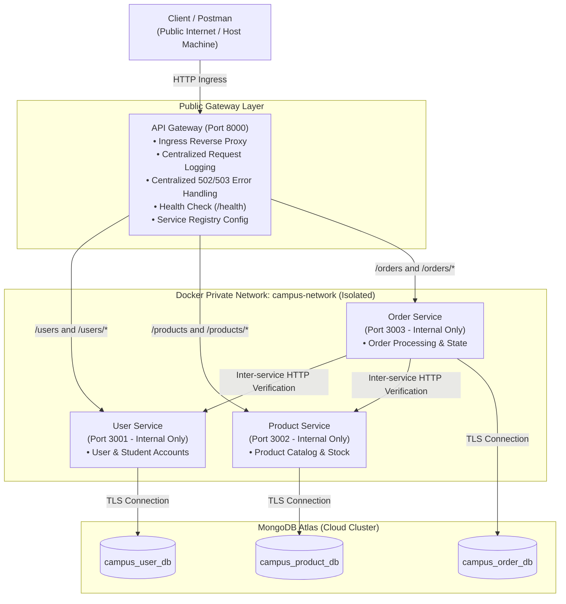

### 3.2 Network Boundaries (Local vs. Cloud)

- **Local Docker Compose**: The API Gateway container publishes port `8000:8000` to the host machine. The User (`3001`), Product (`3002`), and Order (`3003`) services use `expose` to communicate strictly over the internal bridge network `campus-network`. External clients cannot access backend microservices directly.
- **Cloud (Render)**: In the cloud, the API Gateway is deployed as a public web service with a public URL ([`https://campusconnect-api-gateway-xg0y.onrender.com`](https://campusconnect-api-gateway-xg0y.onrender.com)). Backend microservices are deployed as containerized web services whose locations are injected into the gateway via dynamic Render environment variables.

---

## 4. Gateway Endpoints & Routing Table

The API Gateway acts as the single entry point, routing requests while preserving query parameters, headers, HTTP methods, and bodies:

| Ingress Gateway Path | HTTP Method | Target Backend Service | Target Internal URL                         | Description                                            |
| :------------------- | :---------- | :--------------------- | :------------------------------------------ | :----------------------------------------------------- |
| `GET /health`        | `GET`       | **API Gateway**        | _(Handled locally, no proxying)_            | Returns gateway status UP, port, and service registry  |
| `/users`             | `GET`       | **User Service**       | `http://user-service:3001/users`            | Fetch all user and student records                     |
| `/users/{id}`        | `GET`       | **User Service**       | `http://user-service:3001/users/{id}`       | Fetch user by ID                                       |
| `/users`             | `POST`      | **User Service**       | `http://user-service:3001/users`            | Create a new user/student                              |
| `/users/{id}`        | `PUT`       | **User Service**       | `http://user-service:3001/users/{id}`       | Update existing user/student                           |
| `/users/{id}`        | `DELETE`    | **User Service**       | `http://user-service:3001/users/{id}`       | Delete user/student                                    |
| `/products`          | `GET`       | **Product Service**    | `http://product-service:3002/products`      | Fetch product catalog                                  |
| `/products/{id}`     | `GET`       | **Product Service**    | `http://product-service:3002/products/{id}` | Fetch product by ID                                    |
| `/products`          | `POST`      | **Product Service**    | `http://product-service:3002/products`      | Create new product item                                |
| `/products/{id}`     | `PUT`       | **Product Service**    | `http://product-service:3002/products/{id}` | Update product item                                    |
| `/products/{id}`     | `DELETE`    | **Product Service**    | `http://product-service:3002/products/{id}` | Delete product item                                    |
| `/orders`            | `GET`       | **Order Service**      | `http://order-service:3003/orders`          | List all orders                                        |
| `/orders/{id}`       | `GET`       | **Order Service**      | `http://order-service:3003/orders/{id}`     | Fetch order by ID                                      |
| `/orders`            | `POST`      | **Order Service**      | `http://order-service:3003/orders`          | Create order (validates user & product before storing) |

---

## 5. Discussion Questions & Analysis

### Question 1: Why introduce an API Gateway instead of letting clients call each service directly?

Direct client-to-service communication creates significant architectural, operational, and security liabilities:

1. **Single Public Ingress Point & Encapsulation**: Without a gateway, clients must know and manage multiple hostnames, IP addresses, and ports. Any backend refactoring, service splitting, or migration breaks clients. The API Gateway shields the internal topology behind a uniform domain.
2. **Security & Attack Surface Reduction**: Directly exposing microservices requires opening multiple firewall ports. With an API Gateway, only one entry port (8000) is exposed, and microservices remain completely shielded inside a private network.
3. **Centralization of Cross-Cutting Concerns**: Observability (structured logging, request duration tracking), CORS configuration, rate limiting, and uniform error translation belong at the ingress edge. Repeating these across every microservice leads to duplication and configuration drift.
4. **Resilience & Controlled Error Responses**: If a backend service crashes, direct client calls produce raw connection resets or indefinite timeouts. The gateway intercepts backend failures and returns standardized JSON `502 Bad Gateway` or `503 Service Unavailable` responses.

---

### Question 2: Static / Config-Based Discovery vs. Dynamic Service Discovery

In this lab, we implemented **configuration-based service discovery**, where service network locations are externalized into environment variables (`USER_SERVICE_URL`, `PRODUCT_SERVICE_URL`, `ORDER_SERVICE_URL`).

**What would a dynamic registry (e.g., HashiCorp Consul, Netflix Eureka, or Kubernetes DNS) add that a static config file cannot?**

| Capability                        | Static / Config-Based Discovery (Lab 7)                                     | Dynamic Service Discovery (Consul / Eureka / K8s)                                                                           |
| :-------------------------------- | :-------------------------------------------------------------------------- | :-------------------------------------------------------------------------------------------------------------------------- |
| **Service Registration**          | Manual configuration in `.env` / YAML prior to process boot.                | **Self-Registration**: Microservice instances auto-register upon startup with IP, hostname, and ephemeral port.           |
| **Elastic Auto-Scaling**          | Cannot handle dynamic replicas (requires manual URL list update & restart). | **Auto-Scaling Support**: Discovers and balances traffic across multiple running instances dynamically.                     |
| **Active Health Checking**        | Gateway detects failure only when actively forwarding requests.             | **Continuous Heartbeats**: Registry continuously monitors health and automatically deregisters unhealthy instances.        |
| **Zero-Downtime Reconfiguration** | Requires gateway reload/restart when endpoints change.                      | **Event-Driven Push/Pull**: Service instances appear/disappear in real time without restarting the Gateway.                 |
| **Infrastructure Overhead**       | Extremely lightweight; zero external infrastructure dependencies.           | Requires hosting, clustering, and managing dedicated registry servers (consensus protocols like Raft).                      |

**Conclusion**: While static configuration-based discovery is ideal for predictable containerized topologies with fixed service names (like Docker Compose bridge networks), dynamic discovery is essential in cloud-native environments characterized by autoscaling, ephemeral containers, and dynamic port allocation.

---

## 6. Service Discovery Layer (Part B)

### 6.1 Environment Variables

The gateway reads service addresses at boot time:

```bash
# Service Discovery Registry (Externalized Configuration)
USER_SERVICE_URL=http://user-service:3001
PRODUCT_SERVICE_URL=http://product-service:3002
ORDER_SERVICE_URL=http://order-service:3003
```

- In `api-gateway/server.js`, route definitions reference these variables rather than hard-coded URLs.
- When configuration changes, a restart of the gateway container is required for the new addresses to take effect.

### 6.2 Configuration-Change Demonstration

To demonstrate that service routing changes strictly through configuration without modifying application source code:

1. **Initial State**: Gateway configured with `PRODUCT_SERVICE_URL=http://localhost:3002`. Request to `GET /products` routes to port 3002 and succeeds.
2. **Reconfiguration**: Update `PRODUCT_SERVICE_URL=http://localhost:3999` in `.env`. (No code changed in `server.js`).
3. **Gateway Restart**: Restart gateway process.
4. **Verification**: Request to `GET /products` now targets port 3999. Since nothing is listening on 3999, the gateway returns `502 Bad Gateway` pointing to `http://localhost:3999`.
5. **Reversion**: Restore `PRODUCT_SERVICE_URL=http://localhost:3002`, restart, and confirm requests succeed.

*This exact sequence is verified automatically in the test suite `api-gateway/test/config-change.test.js`.*

---

## 7. Verification & Practical Testing (Part D)

### 7.1 Automated Test Suite Results

The automated test suite runs using Node.js native test runner:

```bash
npm --prefix api-gateway test
```

**Actual Execution Output:**

```
> api-gateway@1.0.0 test
> node --test test/**/*.test.js

▶ Part B: Configuration-Based Service Discovery Demonstration
  ✔ Proves gateway routes to a newly configured service URL upon restart with zero code change (403.88ms)
✔ Part B: Configuration-Based Service Discovery Demonstration (406.32ms)
▶ Lab 7 API Gateway & Service Discovery Test Suite
  ✔ 1. GET /health reports UP status and configured service registry without proxying (84.44ms)
  ✔ 2. GET /users/101?query=active forwards to User Service and preserves path & query (33.51ms)
  ✔ 3. POST /users forwards request method and JSON body (19.54ms)
  ✔ 4. GET /products forwards to Product Service (14.30ms)
  ✔ 5. GET /orders returns clear 502/503 error when Order Service is down without crashing (9.99ms)
  ✔ 6. GET /unregistered-route returns 404 Not Found with available endpoints (8.81ms)
  ✔ 7. Failure and Recovery: service stop returns 502, restart recovers to 200 (34.76ms)
✔ Lab 7 API Gateway & Service Discovery Test Suite (466.33ms)
ℹ tests 8
ℹ suites 2
ℹ pass 8
ℹ fail 0
```

---

### 7.2 Hands-On Failure and Recovery Test (Local Docker Verification)

The gateway failure test demonstrates centralized error handling when a backend microservice fails.

> **Verification Environment**: This failure and recovery test procedure was verified in the **local Docker Compose environment** using the Docker CLI to simulate unexpected microservice outages. *(The cloud deployment on Render was verified for live routing and healthy connectivity across all services without disrupting production cloud instances).*

The step-by-step verification procedure:

1. **Step 1 — Start All Services**:
   ```bash
   docker compose up -d
   ```
2. **Step 2 — Send Valid Request**:
   ```bash
   curl -i http://localhost:8000/users
   ```
   **Response**: `HTTP/1.1 200 OK` with JSON array of users.
3. **Step 3 — Stop User Service Only**:
   ```bash
   docker stop user-service
   ```
4. **Step 4 — Send Request Again**:
   ```bash
   curl -i http://localhost:8000/users
   ```
   **Response**: `HTTP/1.1 502 Bad Gateway`
   ```json
   {
     "error": "Bad Gateway",
     "message": "Target service is unreachable or unavailable",
     "targetService": "User Service",
     "targetUrl": "http://user-service:3001",
     "statusCode": 502,
     "details": "connect ECONNREFUSED",
     "timestamp": "2026-10-14T17:45:00.000Z"
   }
   ```
   *The gateway logs the error and remains running without crashing or hanging.*
5. **Step 5 — Restart User Service**:
   ```bash
   docker start user-service
   ```
6. **Step 6 — Verify Recovery**:
   ```bash
   curl -i http://localhost:8000/users
   ```
   **Response**: `HTTP/1.1 200 OK` — The gateway automatically recovers without needing a restart.

---

## 8. How to Run Locally via Docker Compose (Part C)

### 8.1 Setup Prerequisites

- Node.js v20+ and npm installed
- Docker Engine & Docker Compose installed

### 8.2 Configuration

1. Copy `.env.example` to `.env`:
   ```bash
   cp .env.example .env
   ```
2. Configure your MongoDB Atlas connection strings in `.env`:
   ```env
   PORT=8000
   USER_SERVICE_URL=http://user-service:3001
   PRODUCT_SERVICE_URL=http://product-service:3002
   ORDER_SERVICE_URL=http://order-service:3003
   
   USER_SERVICE_MONGO_URI=mongodb+srv://<user>:<password>@cluster0.h3j48jw.mongodb.net/campus_user_db?retryWrites=true&w=majority
   PRODUCT_SERVICE_MONGO_URI=mongodb+srv://<user>:<password>@cluster0.h3j48jw.mongodb.net/campus_product_db?retryWrites=true&w=majority
   ORDER_SERVICE_MONGO_URI=mongodb+srv://<user>:<password>@cluster0.h3j48jw.mongodb.net/campus_order_db?retryWrites=true&w=majority
   ```

### 8.3 Docker Compose Commands

```bash
# Build and start all services
docker compose up --build -d

# Verify running containers and port bindings
docker compose ps

# View gateway centralized logs in real time
docker compose logs -f api-gateway

# Stop all containers
docker compose down
```

### 8.4 Port Exposure Verification

When running `docker compose ps`, only port `8000` is exposed to the host machine:
- `api-gateway` -> `0.0.0.0:8000->8000/tcp`
- `user-service` -> `3001/tcp` (Internal only)
- `product-service` -> `3002/tcp` (Internal only)
- `order-service` -> `3003/tcp` (Internal only)

## 9. Cloud Deployment on Render (Part E)

### 9.1 Render Blueprint & Deployment Metadata

The microservices architecture is containerized and deployed to the **Render Cloud Platform** using Render Blueprints (`render.yaml`):

- **Render Blueprint Name**: `campus-connect-lab7`
- **GitHub Repository**: [`https://github.com/varunee-it/campus-connect-microservices`](https://github.com/varunee-it/campus-connect-microservices)
- **Deployment Branch**: `main`
- **Public API Gateway URL**: [`https://campusconnect-api-gateway-xg0y.onrender.com`](https://campusconnect-api-gateway-xg0y.onrender.com)
- **Live Endpoint Links**:
  - `GET /health`: [`https://campusconnect-api-gateway-xg0y.onrender.com/health`](https://campusconnect-api-gateway-xg0y.onrender.com/health)
  - `GET /users`: [`https://campusconnect-api-gateway-xg0y.onrender.com/users`](https://campusconnect-api-gateway-xg0y.onrender.com/users)
  - `GET /products`: [`https://campusconnect-api-gateway-xg0y.onrender.com/products`](https://campusconnect-api-gateway-xg0y.onrender.com/products)
  - `GET /orders`: [`https://campusconnect-api-gateway-xg0y.onrender.com/orders`](https://campusconnect-api-gateway-xg0y.onrender.com/orders)

---

### 9.2 The Four Render Microservices & Gateway Routing Architecture

The cloud architecture consists of four distinct web services defined in `render.yaml`:

| Render Service Name | Service Type | Internal Port | Public URL / Internal Host | Role & Responsibilities |
| :------------------ | :----------- | :------------ | :-------------------------- | :---------------------- |
| **`campusconnect-api-gateway`** | Web Service (Docker) | `8000` | [`https://campusconnect-api-gateway-xg0y.onrender.com`](https://campusconnect-api-gateway-xg0y.onrender.com) | **Public Entry Point & Reverse Proxy**: Unified ingress for all external clients. Dispatches `/users/*`, `/products/*`, and `/orders/*` to backend microservices, tracks request latency, enforces structured logging, and returns standardized JSON `502 Bad Gateway` / `503 Service Unavailable` responses on backend failures. |
| **`campusconnect-user-service`** | Web Service (Docker) | `3001` | `https://campusconnect-user-service-03do.onrender.com` | **User Microservice**: Manages user profiles, student registrations, schemas, and queries against MongoDB Atlas (`campus_user_db`). |
| **`campusconnect-product-service`** | Web Service (Docker) | `3002` | `https://campusconnect-product-service-jodx.onrender.com` | **Product Microservice**: Manages the product catalog, stock inventory, prices, and queries against MongoDB Atlas (`campus_product_db`). |
| **`campusconnect-order-service`** | Web Service (Docker) | `3003` | `https://campusconnect-order-service-9a8u.onrender.com` | **Order Microservice**: Manages order creation and order lifecycle against MongoDB Atlas (`campus_order_db`). Performs synchronous HTTP verification against User Service and Product Service before completing an order. |

#### Service Discovery & Environment-Variable Routing

In Render, dynamic inter-service discovery is managed via environment variables:

1. In `render.yaml`, the gateway receives backend addresses using `fromService`:
   ```yaml
   envVars:
     - key: USER_SERVICE_URL
       fromService:
         type: web
         name: campusconnect-user-service
         property: host
     - key: PRODUCT_SERVICE_URL
       fromService:
         type: web
         name: campusconnect-product-service
         property: host
     - key: ORDER_SERVICE_URL
       fromService:
         type: web
         name: campusconnect-order-service
         property: host
   ```
2. Render injects service hostnames (e.g., `campusconnect-user-service-03do`).
3. The API Gateway (`api-gateway/server.js`) utilizes a built-in `formatUrl()` normalizer:
   - If an internal Render host slug is supplied, it is automatically formatted to `https://<host>.onrender.com`.
   - If a full URL or Docker hostname (`http://user-service:3001`) is supplied, it is preserved without modification.
4. This architecture achieves **true environment parity**: the exact same application code and Docker images run seamlessly in both local Docker Compose and Render Cloud.

---

### 9.3 Deployment Verification & Actual Live Evidence

All four endpoints on the live Render deployment were verified using HTTP requests.

#### 1. Live Gateway Health Check

Request:
```bash
curl.exe -s https://campusconnect-api-gateway-xg0y.onrender.com/health
```

Actual Response (`HTTP 200 OK`):
```json
{
  "service": "api-gateway",
  "status": "UP",
  "port": 8000,
  "timestamp": "2026-10-15T09:43:00.043Z",
  "serviceRegistry": {
    "userService": "https://campusconnect-user-service-03do.onrender.com",
    "productService": "https://campusconnect-product-service-jodx.onrender.com",
    "orderService": "https://campusconnect-order-service-9a8u.onrender.com"
  }
}
```

*Verification Finding*: The gateway is live, reports `status: "UP"`, and successfully displays the resolved cloud URLs for all three backend microservices in its active service registry.

#### 2. Live Microservice Routing Verification

```bash
# 1. User Service Route via Gateway
curl.exe -s https://campusconnect-api-gateway-xg0y.onrender.com/users
# Output: []

# 2. Product Service Route via Gateway
curl.exe -s https://campusconnect-api-gateway-xg0y.onrender.com/products
# Output: []

# 3. Order Service Route via Gateway
curl.exe -s https://campusconnect-api-gateway-xg0y.onrender.com/orders
# Output: []
```

#### Important Verification Notes:

- **Database State (`[]`)**: The empty JSON arrays (`[]`) returned by `/users`, `/products`, and `/orders` confirm that the API Gateway successfully proxied each request to the corresponding backend microservice, and each microservice successfully connected to its designated MongoDB Atlas database collection (`campus_user_db`, `campus_product_db`, `campus_order_db`) returning 0 records. This confirms complete end-to-end routing, container execution, and database connectivity. It does *not* claim that pre-existing database records or mutations were tested in the cloud.
- **Failure and Recovery Test Scope**: The failure-handling and automatic recovery test procedure (stopping a service to trigger `502 Bad Gateway` and restarting it to restore `200 OK`) was executed and verified **locally in Docker Compose** (documented in Section 7.2). It was *not* executed against the live Render cloud deployment to maintain production availability and avoid intentionally disrupting active cloud services.

---

## 10. Limitations and Cloud Notes

When interacting with the live Render cloud deployment, keep in mind the operational characteristics of Render Free Tier instances:

1. **Free-Tier Inactivity Spin-Down**: Render free web services spin down into a sleep state after 15 minutes of inactivity to preserve compute resources.
2. **Cold-Start Delay**: If services are dormant, the first incoming request triggers an automated spin-up cycle. The initial request may take **50–120 seconds** while the container initializes, boots Node.js, and establishes a secure TLS connection to MongoDB Atlas.
3. **Subsequent Low Latency**: Once awakened, the container remains warm, and subsequent requests execute with normal sub-100ms response times.
4. **Initial Database Collections**: Since the MongoDB Atlas databases were newly initialized for this deployment, GET collections return empty arrays (`[]`) until records are populated via POST requests.

---

## 11. Postman Collection & API Testing

The repository provides a complete, pre-configured Postman collection ready for import:

```
postman/Lab7_API_Gateway.postman_collection.json
```

### Environment Switching: Local vs. Cloud

The collection defines a parameterized `{{baseUrl}}` variable, allowing instant switching between environments:

| Environment | Variable Name | URL Value | Usage / Prerequisite |
| :---------- | :------------ | :-------- | :------------------- |
| **Local Environment** | `{{baseUrl}}` | `http://localhost:8000` | Requires `docker compose up -d` running locally. |
| **Public Cloud (Render)** | `{{baseUrl}}` | `https://campusconnect-api-gateway-xg0y.onrender.com` | Directly callable over the public internet. |

> **Note**: Microservice ports (`3001`, `3002`, `3003`) are internal only and cannot be accessed directly by clients. All requests must target the API Gateway (`8000` locally, or the public Render URL in the cloud).

### Included Requests & Assertions:

1. **`0. Gateway Health Check`**: `GET /health` — Asserts `200 OK`, `status === "UP"`, and service registry presence.
2. **`1. User Service Routes`**:
   - `GET /users`: List users (asserts `200 OK`).
   - `GET /users/:id`: Get single user (asserts `200 OK`).
   - `POST /users`: Create user (asserts `201 Created` with created user ID).
   - `PUT /users/:id`: Update user (asserts `200 OK`).
   - `DELETE /users/:id`: Delete user (asserts `200 OK`).
3. **`2. Product Service Routes`**:
   - `GET /products`: List products (asserts `200 OK`).
   - `GET /products/:id`: Get single product (asserts `200 OK`).
   - `POST /products`: Create product item (asserts `201 Created`).
   - `PUT /products/:id`: Update product item (asserts `200 OK`).
   - `DELETE /products/:id`: Delete product item (asserts `200 OK`).
4. **`3. Order Service Routes`**:
   - `GET /orders`: List orders (asserts `200 OK`).
   - `GET /orders/:id`: Get single order (asserts `200 OK`).
   - `POST /orders`: Place order with inter-service validation (asserts `201 Created`).
5. **`4. Resilience & Error Handling`**:
   - Service Unreachable Test: Asserts `502 Bad Gateway` or `503 Service Unavailable` with structured JSON error payload.
   - Service Recovery Test: Asserts `200 OK` after service restoration.

---

## 12. Security Best Practices

1. **Zero Committed Secrets**: `.env` is ignored by Git via `.gitignore`. Real credentials, database passwords, and connection strings are never committed to version control.
2. **Safe Placeholder Templates**: `.env.example` contains only sanitized dummy placeholders:
   ```env
   USER_SERVICE_MONGO_URI=mongodb+srv://<username>:<password>@cluster0.xxxxx.mongodb.net/campus_user_db?retryWrites=true&w=majority
   PRODUCT_SERVICE_MONGO_URI=mongodb+srv://<username>:<password>@cluster0.xxxxx.mongodb.net/campus_product_db?retryWrites=true&w=majority
   ORDER_SERVICE_MONGO_URI=mongodb+srv://<username>:<password>@cluster0.xxxxx.mongodb.net/campus_order_db?retryWrites=true&w=majority
   ```
3. **Container Network Isolation**: In Docker Compose, microservice ports (`3001`, `3002`, `3003`) are declared using `expose` rather than `ports`. Only the API Gateway (`8000:8000`) is accessible from the host.
4. **Bounded Proxy Timeouts**: The gateway enforces bounded proxy timeouts (`PROXY_TIMEOUT_MS=5000`) to prevent client requests from hanging indefinitely if a backend service stalls.
5. **Sanitized Observability Logging**: Gateway request logging captures HTTP method, URL, status code, and latency, while suppressing sensitive authorization headers, bearer tokens, and credentials.

---

## 13. Written Reflection (Lab 6 vs. Lab 7)

Introducing the API Gateway and cloud deployment fundamentally transformed how the CampusConnect system operates compared to Lab 6. In Lab 6, clients acted as distributed orchestrators, juggling disparate port numbers, internal hostnames, and unhandled network drops. With Lab 7, clients interact solely through a unified ingress gateway that conceals internal topology, shields microservices inside a private network, and standardizes cross-cutting logging and 502/503 error handling. Furthermore, replacing hard-coded service URLs with configuration-based service discovery enables seamless promotion between local Docker environments and cloud hosting without modifying a single line of application source code.

---

## 14. Verification Screenshots & Evidence Checklist

The `Screenshots/` directory contains 13 verified image captures documenting the implementation, local execution, and cloud deployment:

| Screenshot | File Path | Verified Item |
| :--- | :--- | :--- |
| **01** | `Screenshots/01-lab6-services-running.png` | Lab 6 microservices running prior to gateway integration |
| **02** | `Screenshots/02-gateway-project-structure.png` | Complete project structure and gateway service directory |
| **03** | `Screenshots/03-gateway-dockerfile.png` | Dockerfile configuration for api-gateway |
| **04** | `Screenshots/04-compose-yaml-gateway.png` | `compose.yaml` showing only gateway port 8000 published |
| **05** | `Screenshots/05-docker-compose-up.png` | Docker containers running together on common bridge network |
| **06** | `Screenshots/06-gateway-health-check.png` | `GET /health` returning UP and active service registry |
| **07** | `Screenshots/07-postman-users-via-gateway.png` | User CRUD operations routed successfully through gateway |
| **08** | `Screenshots/08-postman-products-via-gateway.png` | Product CRUD operations routed successfully through gateway |
| **09** | `Screenshots/09-postman-orders-via-gateway.png` | Order operations and inter-service validation via gateway |
| **10** | `Screenshots/10-postman-502-unreachable.png` | Gateway 502 Bad Gateway response when backend is down |
| **11** | `Screenshots/11-service-discovery-config.png` | Configuration change demonstration without code changes |
| **12** | `Screenshots/12-cloud-deployment-dashboard.png` | Render Cloud deployment dashboard showing healthy services |
| **13** | `Screenshots/13-postman-cloud-tests.png` | Live Postman requests executing against public gateway URL |

---

# Web Services and SOA — Laboratory 8

## Kubernetes Orchestration, GitHub Actions CI/CD & Prometheus/Grafana Monitoring

**Primary Goal**: Operationalize the Lab 7 CampusConnect microservices application on Kubernetes (`lab8` namespace), automate test execution and versioned container image publishing via GitHub Actions CI/CD to GitHub Container Registry (GHCR), and establish real-time observability using Prometheus and Grafana.

---

### 15.1 System Architecture & Kubernetes Topology

The application preserves the microservices contracts established in Lab 6 and Lab 7. In Lab 8, the entire stack is orchestrated within the `lab8` Kubernetes namespace on Docker Desktop Kubernetes.

**Request Flow**:
```
Client / Postman
  │  (HTTP Host Port: 30080 or port-forward: 8000)
  ▼
API Gateway Service (NodePort: 30080 / Port: 8000)
  │
  ├──► /users/*    ──► User Service (ClusterIP: 3001)    ──► MongoDB Atlas (campus_user_db)
  ├──► /products/* ──► Product Service (ClusterIP: 3002) ──► MongoDB Atlas (campus_product_db)
  └──► /orders/*   ──► Order Service (ClusterIP: 3003)   ──► MongoDB Atlas (campus_order_db)
                             │
                             ├──► Inter-service verification: http://user-service:3001
                             └──► Inter-service verification: http://product-service:3002
```

#### Mermaid Architecture Diagram

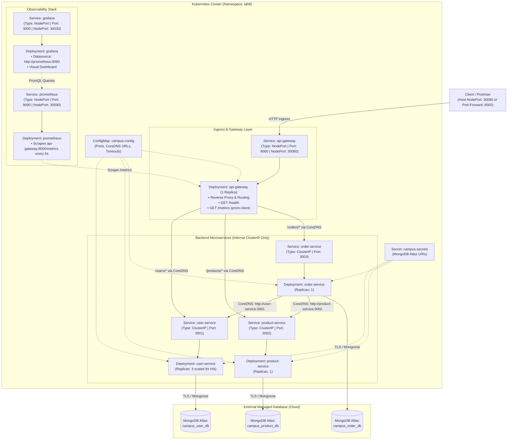

---

### 15.2 Kubernetes Manifests & Configuration Architecture

All Kubernetes manifests are located in the [`k8s/`](k8s/) directory and explicitly belong to `namespace: lab8`.

| Manifest File | Kubernetes Kind | Description | Ports / Probes |
| :--- | :--- | :--- | :--- |
| [`k8s/namespace.yaml`](k8s/namespace.yaml) | `Namespace` | Defines the isolated `lab8` namespace | N/A |
| [`k8s/configmap.yaml`](k8s/configmap.yaml) | `ConfigMap` | Non-sensitive configs (`GATEWAY_PORT: 8000`, `USER_PORT: 3001`, `PRODUCT_PORT: 3002`, `ORDER_PORT: 3003`, `USER_SERVICE_URL: http://user-service:3001`, `PRODUCT_SERVICE_URL: http://product-service:3002`, `ORDER_SERVICE_URL: http://order-service:3003`, `PROXY_TIMEOUT_MS: 5000`, `HTTP_TIMEOUT_MS: 3000`) | N/A |
| [`k8s/secret.yaml.example`](k8s/secret.yaml.example) | `Secret` | Committed template with sanitized placeholders (`USER_SERVICE_MONGO_URI`, `PRODUCT_SERVICE_MONGO_URI`, `ORDER_SERVICE_MONGO_URI`) | N/A |
| `k8s/secret.yaml` | `Secret` | **Locally generated only** containing actual Atlas URIs. Strictly ignored by `.gitignore` and never committed to Git. | N/A |
| [`k8s/gateway-deployment.yaml`](k8s/gateway-deployment.yaml) | `Deployment` | 1 replica of `api-gateway:v1`, pulls from ConfigMap, resource limits (250m CPU, 256Mi RAM) | Liveness & Readiness: `GET /health` on port `8000` |
| [`k8s/gateway-service.yaml`](k8s/gateway-service.yaml) | `Service` | `NodePort` service exposing port `8000` on host port `30080` | Port: 8000, NodePort: 30080 |
| [`k8s/user-deployment.yaml`](k8s/user-deployment.yaml) | `Deployment` | Scaled to 3 replicas of `user-service:v1`, MongoDB URI via `secretKeyRef` | Liveness & Readiness: `GET /health` on port `3001` |
| [`k8s/user-service.yaml`](k8s/user-service.yaml) | `Service` | Internal `ClusterIP` on port `3001` | Port: 3001 |
| [`k8s/product-deployment.yaml`](k8s/product-deployment.yaml) | `Deployment` | 1 replica of `product-service:v1`, MongoDB URI via `secretKeyRef` | Liveness & Readiness: `GET /health` on port `3002` |
| [`k8s/product-service.yaml`](k8s/product-service.yaml) | `Service` | Internal `ClusterIP` on port `3002` | Port: 3002 |
| [`k8s/order-deployment.yaml`](k8s/order-deployment.yaml) | `Deployment` | 1 replica of `order-service:v1`, configured with dependent service URLs | Liveness & Readiness: `GET /health` on port `3003` |
| [`k8s/order-service.yaml`](k8s/order-service.yaml) | `Service` | Internal `ClusterIP` on port `3003` | Port: 3003 |
| [`k8s/prometheus.yaml`](k8s/prometheus.yaml) | `Deployment` + `Svc` + `CM` | Prometheus v2.54.1 with ConfigMap scraping `api-gateway:8000/metrics` every 5s | Port: 9090, NodePort: 30090 |
| [`k8s/grafana.yaml`](k8s/grafana.yaml) | `Deployment` + `Svc` + `CM` | Grafana 11.2.0 with auto-provisioned Prometheus datasource | Port: 3000, NodePort: 30030 |
| [`k8s/grafana-dashboard.json`](k8s/grafana-dashboard.json) | JSON Asset | Pre-built dashboard JSON covering traffic rate, latency, and status codes | N/A |

> **Security Guardrail**: `k8s/secret.yaml` contains real credentials and is **strictly excluded** by Git (`.gitignore` rule: `k8s/secret.yaml`). Only [`k8s/secret.yaml.example`](k8s/secret.yaml.example) is committed.

---

### 15.3 Kubernetes Setup & Cluster Operations

#### 1. Cluster Verification
The Kubernetes cluster runs on Docker Desktop with context `docker-desktop`:
```powershell
# Verify active context
kubectl config current-context
# Output: docker-desktop

# Verify node availability
kubectl get nodes
# Output: desktop-control-plane   Ready   control-plane   v1.36.1
```

#### 2. Apply Manifests in Order
All manifests belong explicitly to the isolated `lab8` namespace:
```powershell
# 1. Create namespace
kubectl apply -f k8s/namespace.yaml

# 2. Apply non-sensitive configuration
kubectl apply -f k8s/configmap.yaml

# 3. Apply sensitive database credentials (locally generated from secret.yaml.example; excluded from Git)
kubectl apply -f k8s/secret.yaml

# 4. Deploy internal microservices
kubectl apply -f k8s/user-service.yaml
kubectl apply -f k8s/user-deployment.yaml
kubectl apply -f k8s/product-service.yaml
kubectl apply -f k8s/product-deployment.yaml
kubectl apply -f k8s/order-service.yaml
kubectl apply -f k8s/order-deployment.yaml

# 5. Deploy API Gateway (Ingress Reverse Proxy)
kubectl apply -f k8s/gateway-service.yaml
kubectl apply -f k8s/gateway-deployment.yaml

# 6. Deploy Prometheus & Grafana Monitoring Stack
kubectl apply -f k8s/prometheus.yaml
kubectl apply -f k8s/grafana.yaml
```

#### 3. Inspect Running Resources
```powershell
kubectl get pods -n lab8
kubectl get deployments -n lab8
kubectl get services -n lab8
kubectl get endpoints -n lab8
```

**Verified Resource State**:
```
NAME                              READY   STATUS    RESTARTS   AGE
api-gateway-54645dc599-hk6wt      1/1     Running   0          69m
grafana-67589cc796-f2mbt          1/1     Running   0          69m
order-service-5946cb5d78-8gnsf    1/1     Running   0          69m
product-service-9fdc5f9b6-q6x9t   1/1     Running   0          69m
prometheus-6b4d4549d7-c4gwx       1/1     Running   0          69m
user-service-685675b8f7-4pzhq     1/1     Running   0          43m
user-service-685675b8f7-f582l     1/1     Running   0          69m
user-service-685675b8f7-m9dqg     1/1     Running   0          45m
```

#### 4. Accessing Services (NodePort & Port-Forwarding)
On Windows Docker Desktop, Kubernetes NodePort ports are mapped inside the Linux VM. Active services can be accessed either via NodePort or via `kubectl port-forward`:

| Service | NodePort | Port-Forward Command | Local Endpoint | Credentials / Purpose |
| :--- | :--- | :--- | :--- | :--- |
| **API Gateway** | `30080` | `kubectl port-forward -n lab8 service/api-gateway 8080:8000` | `http://localhost:8080` | Client ingress (`/health`, `/metrics`, `/users`, `/products`, `/orders`) |
| **Prometheus** | `30090` | `kubectl port-forward -n lab8 service/prometheus 9090:9090` | `http://localhost:9090` | Scrape targets UI & PromQL query engine |
| **Grafana** | `30030` | `kubectl port-forward -n lab8 service/grafana 3000:3000` | `http://localhost:3000` | Real-time visual dashboards (`admin` / `admin`) |

#### 5. Live Gateway Verification (HTTP 200 Ingress Tests)
Two live gateway HTTP requests were executed through port-forwarding (`localhost:8080` forwarding to Gateway port `8000`) and verified with `curl.exe -i`:

**1. Gateway Health Check (`GET /health`)**:
```powershell
curl.exe -i http://localhost:8080/health
```
```http
HTTP/1.1 200 OK
X-Powered-By: Express
Access-Control-Allow-Origin: *
Content-Type: application/json; charset=utf-8
Content-Length: 241
ETag: W/"f1-4cUAiHlcSzCCecDUfmtv6Wa8TI8"
Date: Thu, 15 Oct 2026 13:18:50 GMT
Connection: keep-alive
Keep-Alive: timeout=5

{"service":"api-gateway","status":"UP","port":8000,"timestamp":"2026-10-15T13:18:50.150Z","serviceRegistry":{"userService":"http://user-service:3001","productService":"http://product-service:3002","orderService":"http://order-service:3003"}}
```
*Verification Finding*: Returns `HTTP/1.1 200 OK`, reports `status: "UP"`, and confirms active CoreDNS service registry addresses for User, Product, and Order services.

**2. Microservice Reverse Proxying (`GET /users`)**:
```powershell
curl.exe -i http://localhost:8080/users
```
```http
HTTP/1.1 200 OK
x-powered-by: Express
access-control-allow-origin: *
content-type: application/json; charset=utf-8
content-length: 197
etag: W/"c5-d3JkCGFX7zsp3sicVuMzRI8ei8o"
date: Thu, 15 Oct 2026 13:18:59 GMT
connection: close

[{"name":"Varunee Agrawal","email":"varunee@dau.ac.in","course":"MSc IT","semester":3,"createdAt":"2026-10-15T10:22:22.197Z","updatedAt":"2026-10-15T10:22:22.197Z","id":"6ad0a95e619407056af424ae"}]
```
*Verification Finding*: Returns `HTTP/1.1 200 OK`, verifying that the API Gateway successfully proxies client traffic to `http://user-service:3001/users`, which connects securely to MongoDB Atlas and retrieves existing user entity data.

#### 6. Kubernetes Diagnostic & Troubleshooting Verification
Cluster status was verified using standard Kubernetes diagnostic commands:

**1. Service Endpoints Inspection**:
```powershell
kubectl get endpoints -n lab8
```
```
NAME              ENDPOINTS                                              AGE
api-gateway       10.244.0.8:8000                                        124m
grafana           10.244.0.10:3000                                       124m
order-service     10.244.0.7:3003                                        125m
product-service   10.244.0.6:3002                                        125m
prometheus        10.244.0.9:9090                                        124m
user-service      10.244.0.11:3001,10.244.0.13:3001,10.244.0.5:3001     125m
```
*Finding*: Endpoints exist for all 6 deployed services. Crucially, `user-service` lists three active IP endpoints (`10.244.0.11:3001`, `10.244.0.13:3001`, `10.244.0.5:3001`), confirming horizontal replica distribution.

**2. API Gateway Pod Status & Health Probes**:
```powershell
kubectl describe pod -l app=api-gateway -n lab8
```
*Finding*: The API Gateway pod (`api-gateway-54645dc599-hk6wt`) is in `Running` status, with container state `Running` and both Liveness probe (`GET http://:8000/health`) and Readiness probe (`GET http://:8000/health`) passing continuously.

**3. Gateway Routing Logs**:
```powershell
kubectl logs -l app=api-gateway -n lab8 --tail=20
```
*Finding*: Real-time gateway logs confirm ingress requests routed with HTTP status `200` to User, Product, and Order services with recorded response latencies.

---

### 15.4 Scaling and Self-Healing Demonstrations

#### Demonstration 1: Scaling User Service to 3 Replicas
The User Service Deployment was horizontally scaled from 1 to 3 replicas:
```powershell
kubectl scale deployment user-service --replicas=3 -n lab8
kubectl get deployment user-service -n lab8
```
**Verified Result**:
```
NAME           READY   UP-TO-DATE   AVAILABLE   AGE
user-service   3/3     3            3           69m
```
All three pods (`user-service-685675b8f7-4pzhq`, `user-service-685675b8f7-f582l`, `user-service-685675b8f7-m9dqg`) reached `1/1 Ready` and `Running` status. Traffic across the 3 backend pods is automatically distributed via the Kubernetes `user-service` ClusterIP endpoint slice.

#### Demonstration 2: Self-Healing Pod Replacement
To verify Kubernetes self-healing resilience against unexpected container failure:
```powershell
# 1. Delete an active User Service Pod
kubectl delete pod user-service-685675b8f7-kslww -n lab8

# 2. Watch Kubernetes ReplicaSet automatically detect failure and reconcile state
kubectl get pods -n lab8 -w
```
**Verified Result**:
The deleted pod entered `Terminating` status. Within 43 seconds, the Kubernetes ReplicaSet detected the mismatch in desired state (3 desired, 2 current) and provisioned replacement pod `user-service-685675b8f7-4pzhq`, which passed readiness checks and reached `1/1 Running`.

---

### 15.5 GitHub Actions CI/CD Pipeline & Kubernetes Image Rollout

#### 1. CI/CD Pipeline Architecture
The automated workflow in [`.github/workflows/ci-cd.yml`](.github/workflows/ci-cd.yml) executes on every `push` and `pull_request` to `main`:

```
Git Push to main
  │
  ├──► Stage 1: Run Automated Tests
  │       • Ubuntu runner, Node.js 22 runtime
  │       • Executes native test runner: npm ci && npm test in api-gateway
  │       • Asserts all unit and regression tests pass (including /metrics test)
  │
  ├──► Stage 2: Build & Publish Container Images
  │       • Matrix build for all 4 microservices:
  │         - api-gateway
  │         - user-service
  │         - product-service
  │         - order-service
  │       • Authenticates securely to GitHub Container Registry (ghcr.io) via GITHUB_TOKEN
  │       • Tags versioned images with the exact Git commit SHA and latest:
  │         - ghcr.io/varunee-it/api-gateway:<commit-sha>
  │         - ghcr.io/varunee-it/user-service:<commit-sha>
  │         - ghcr.io/varunee-it/product-service:<commit-sha>
  │         - ghcr.io/varunee-it/order-service:<commit-sha>
  │
  └──► Stage 3: Guarded Kubernetes Deployment
          • Guard Condition: secrets.KUBECONFIG_DATA != ''
          • If KUBECONFIG_DATA is unset: Logs an informative notice and cleanly completes without failing.
          • If KUBECONFIG_DATA is present: Configures kubeconfig, applies manifests, and verifies rollout status.
```

#### 2. Verified Pipeline Run (Commit `14fc704`)
The GitHub Actions run for commit `14fc704` (`feat: add Kubernetes CI/CD and monitoring for Lab 8`) completed with status **Success** in 1m 9s:
- **Run Automated Tests**: Passed in 8 seconds.
- **Build & Publish**: Matrix build successfully pushed all 4 container images to GitHub Packages (GHCR).
- **Guarded Deploy Stage**: Evaluated guard conditions cleanly.

#### 3. Critical Distinction: Remote CI Job vs. Local Kubernetes Rollout
To ensure strict academic and technical clarity:
- **GitHub Actions Deployment Job**: In CI/CD run #1 (commit `14fc704`), Stage 3 evaluated the guard condition `secrets.KUBECONFIG_DATA != ''`. Because `KUBECONFIG_DATA` was not configured in GitHub repository secrets, the pipeline logged an informative notice (`KUBECONFIG_DATA secret is not configured; skipping automated cluster deployment.`) and cleanly skipped remote deployment. The CI job did *not* directly deploy to the cluster.
- **Local Kubernetes Image Rollout**: To demonstrate continuous delivery and zero-downtime rolling updates on the active `docker-desktop` Kubernetes cluster, an explicit image update was executed locally using the versioned GHCR image tag generated from commit `3b60bc2`:
  ```
  ghcr.io/varunee-it/api-gateway:3b60bc2b60fa9f5c2596227f6f06c15eb407ffb4
  ```

#### 4. Verified Kubernetes Image Rollout Procedure
The rolling update was performed and verified using PowerShell:
```powershell
# 1. Pull the versioned GHCR image published by the CI pipeline
docker pull ghcr.io/varunee-it/api-gateway:3b60bc2b60fa9f5c2596227f6f06c15eb407ffb4

# 2. Update the API Gateway deployment to the versioned image
kubectl set image deployment/api-gateway api-gateway=ghcr.io/varunee-it/api-gateway:3b60bc2b60fa9f5c2596227f6f06c15eb407ffb4 -n lab8
# Output: deployment.apps/api-gateway image updated

# 3. Monitor rollout progress and verify zero-downtime completion
kubectl rollout status deployment/api-gateway -n lab8
# Output:
# Waiting for deployment "api-gateway" rollout to finish: 1 old replicas are pending termination...
# Waiting for deployment "api-gateway" rollout to finish: 1 old replicas are pending termination...
# deployment "api-gateway" successfully rolled out

# 4. Verify deployment spec matches versioned image tag
kubectl get deployment api-gateway -n lab8 -o jsonpath='{.spec.template.spec.containers[0].image}'
# Output: ghcr.io/varunee-it/api-gateway:3b60bc2b60fa9f5c2596227f6f06c15eb407ffb4
```
*Rollout Finding*: Kubernetes executed a rolling update, spawning a new pod with the versioned GHCR image, waiting for readiness probes to pass, and terminating the previous replica with zero downtime.

---

### 15.6 Prometheus & Grafana Monitoring

#### 1. Prometheus Configuration & Target Verification
The API Gateway is instrumented with `prom-client` in [`api-gateway/server.js`](api-gateway/server.js), exposing standard metrics at `GET /metrics`.

Prometheus is configured in [`k8s/prometheus.yaml`](k8s/prometheus.yaml) with a 5-second scrape interval:
```yaml
scrape_configs:
  - job_name: "api-gateway"
    metrics_path: "/metrics"
    static_configs:
      - targets: ["api-gateway:8000"]
        labels:
          service: "api-gateway"
          app: "campus-connect"
```

**Target Verification**:
Accessing `http://localhost:9090/targets` confirms both scrape targets in state **`UP`**:
- `api-gateway (1/1 up)`: scraping `http://api-gateway:8000/metrics`
- `prometheus (1/1 up)`: scraping `http://localhost:9090/metrics`

#### 2. Supported PromQL Queries
The following metrics are collected from the live gateway and queryable in Prometheus and Grafana:

| Monitoring Question | Supported PromQL Expression | Metric Sourced From Gateway |
| :--- | :--- | :--- |
| **Target Availability** | `up{job="api-gateway"}` | Returns `1` when gateway `/metrics` scrape succeeds |
| **Request Rate (Total)** | `sum(rate(http_requests_total[5m]))` | Measures overall HTTP requests per second |
| **Request Rate by Route** | `sum(rate(http_requests_total[1m])) by (route)` | Ingress request rate broken down by `/users`, `/products`, `/orders`, `/health` |
| **HTTP Error Rate** | `sum(rate(http_requests_total{status_code=~"5.."}[5m]))` | Frequency of 5xx server/gateway errors |
| **Status Code Distribution** | `sum(http_requests_total) by (status_code)` | Total request counts broken down by HTTP status (`200`, `201`, `404`, `502`) |
| **Average Request Latency** | `sum(rate(http_request_duration_seconds_sum[5m])) / sum(rate(http_request_duration_seconds_count[5m]))` | Average duration per HTTP transaction in seconds |
| **95th Percentile Latency** | `histogram_quantile(0.95, sum(rate(http_request_duration_seconds_bucket[5m])) by (le))` | 95th percentile response latency |

#### 3. Grafana Dashboard Analysis & Panel States
The custom Grafana dashboard **`CampusConnect API Monitoring`** (`http://localhost:3000`) monitors real-time gateway operations across three core panels:

1. **`Average API Request Latency`**:
   - PromQL: `sum(rate(http_request_duration_seconds_sum[5m])) / sum(rate(http_request_duration_seconds_count[5m]))`
   - State: Measures response latency across routes. Hovered around a healthy baseline of **~0.002 seconds** (with an earlier initialization peak of ~0.04s during container startup).
2. **`HTTP Error Rate`**:
   - PromQL: `sum(rate(http_requests_total{status_code=~"5.."}[5m]))`
   - State: **`No data`**
   - **Academic Honesty Documentation**: In Prometheus, a `rate()` query filtering on a label value that has never occurred during the query range (`status_code=~"5.."`) yields an empty vector. Grafana legitimately renders this as `No data`. This is documented honestly: it signifies that **zero 5xx server or gateway errors occurred** during the observation period. It must not be misrepresented as a faulty panel or disguised as an artificial zero line.
3. **`API Requests per Second`**:
   - PromQL: `sum(rate(http_requests_total[5m]))`
   - State: Plots incoming request volume over time.

#### 4. Monitoring Traffic Demonstration & Before/After Comparison
To observe metric response to load, synthetic ingress traffic was generated against the API Gateway:

- **Baseline State (Before Additional Traffic)**:
  - As captured in `Screenshots/10-grafana-before-traffic.png`, the baseline request rate hovered steadily around **0.30–0.32 requests/second**, sustained by Prometheus 5-second scrape intervals and background health checks.
- **Traffic Generation Loop**:
  - In PowerShell, a burst of 50 HTTP requests was sent through the API Gateway port-forward:
    ```powershell
    for ($i = 1; $i -le 50; $i++) {
        curl.exe -s http://localhost:8080/users > $null
    }
    ```
- **Observed Metrics (After Traffic)**:
  - As captured in `Screenshots/11-grafana-after-traffic.png`, the 5-minute rolling rate curve on the `API Requests per Second` panel climbed sharply to approximately **0.42 requests/second**.
  - **Empirical Caution**: In strict accordance with academic honesty, this before/after comparison reflects what the monitoring dashboard visibly recorded during the test window. It documents that the calculated rate climbed following the test burst, without making unverified causal claims beyond the empirical metric data.

---

### 15.7 Evidence Screenshots & Deliverables Mapping

The [`Screenshots/`](Screenshots/) directory contains 11 verified evidence image captures documenting Lab 8 implementation, scaling, self-healing, CI/CD, Kubernetes image rollout, and Prometheus/Grafana monitoring.

#### Concise Evidence Table

| Requirement | Evidence | Result |
| :--- | :--- | :--- |
| **CI/CD Pipeline Automated Testing & Matrix Image Build** | [`Screenshots/1-github-actions-success.png`](Screenshots/1-github-actions-success.png) | GitHub Actions workflow run for commit `14fc704` succeeded (automated unit/regression tests passed in 8s, 4 container images built and published, deploy step guarded). |
| **GitHub Container Registry (GHCR) Image Publication** | [`Screenshots/2-github-packages.png`](Screenshots/2-github-packages.png) | All 4 microservice container images (`api-gateway`, `user-service`, `product-service`, `order-service`) published with Git commit SHA and `latest` tags on GitHub Packages. |
| **Prometheus Active Target Scraping** | [`Screenshots/3-prometheus-targets-up.png`](Screenshots/3-prometheus-targets-up.png) | Prometheus UI (`localhost:9090/targets`) confirming both `api-gateway (1/1 up)` scraping `/metrics` and `prometheus (1/1 up)` in `UP` state. |
| **Grafana PromQL Query Visualization** | [`Screenshots/4-grafana-dashboard.png`](Screenshots/4-grafana-dashboard.png) | Grafana Explore query panel actively plotting live gateway ingress traffic rate using `sum(rate(http_requests_total[5m]))`. |
| **Microservice Deployment & Horizontal Scaling** | [`Screenshots/5-prometheus-targets.png`](Screenshots/5-prometheus-targets.png) | PowerShell terminal output showing 8 active pods in `lab8` namespace and `user-service` deployment scaled to `3/3` Ready replicas. |
| **Kubernetes ReplicaSet Self-Healing Resilience** | [`Screenshots/6-kubernetes-self-healing.png`](Screenshots/6-kubernetes-self-healing.png) | Terminal output verifying self-healing: deleting active pod `user-service-685675b8f7-kslww` triggers automatic ReplicaSet recreation of pod `user-service-685675b8f7-4pzhq` in 43s. |
| **API Gateway Ingress & Health Verification** | [`Screenshots/7-gateway-test.png`](Screenshots/7-gateway-test.png) | Port-forwarded requests to `GET /health` (status UP, service registry) and `GET /users` (user entity data) both returning `HTTP/1.1 200 OK`. |
| **Kubernetes Troubleshooting, Probes & Endpoints** | [`Screenshots/8-troubleshooting.png`](Screenshots/8-troubleshooting.png) | Diagnostic output of `kubectl get endpoints -n lab8` (endpoints for all 6 services, including 3 user-service IPs) and `kubectl describe pod` confirming `Running` state and active probes. |
| **Kubernetes Zero-Downtime Versioned Image Rollout** | [`Screenshots/9-kubernetes-rollout.png`](Screenshots/9-kubernetes-rollout.png) | Successful image rollout to `ghcr.io/varunee-it/api-gateway:3b60bc2b60fa9f5c2596227f6f06c15eb407ffb4` via `kubectl set image` and `kubectl rollout status` confirmation. |
| **Grafana Monitoring Dashboard (Baseline State)** | [`Screenshots/10-grafana-before-traffic.png`](Screenshots/10-grafana-before-traffic.png) | `CampusConnect API Monitoring` dashboard before additional load, showing latency (~0.002s), HTTP Error Rate (`No data`), and baseline request rate (~0.32 req/s). |
| **Grafana Monitoring Dashboard (Traffic Load Spike)** | [`Screenshots/11-grafana-after-traffic.png`](Screenshots/11-grafana-after-traffic.png) | `CampusConnect API Monitoring` dashboard after sending a 50-request burst, showing the request-rate graph climbing to approximately 0.42 requests/second. |

#### Visual Evidence Gallery

##### 1. GitHub Actions CI/CD Pipeline Success (Commit `14fc704`)
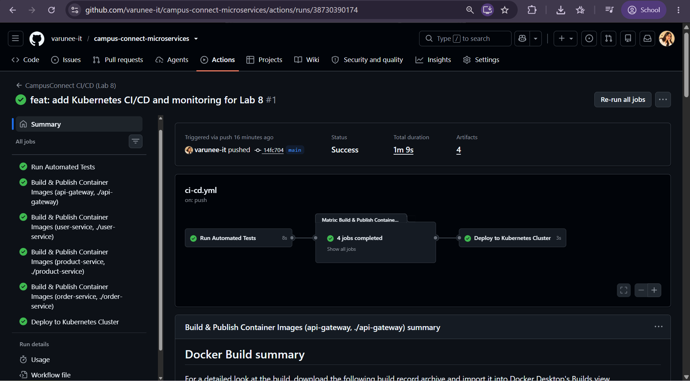

##### 2. Versioned Images Published to GitHub Container Registry (GHCR)
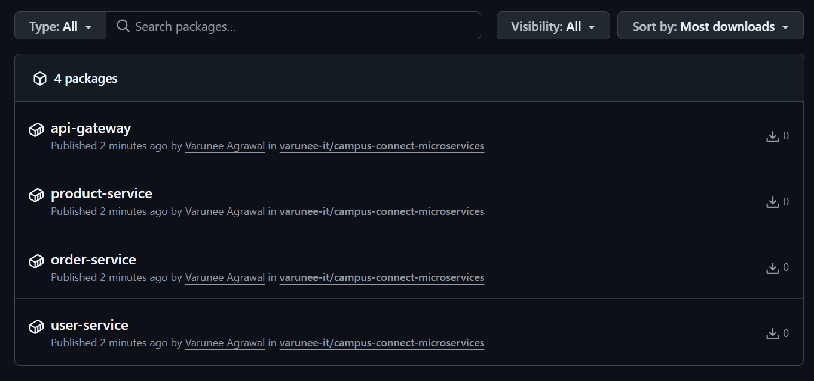

##### 3. Prometheus Targets Reporting UP State
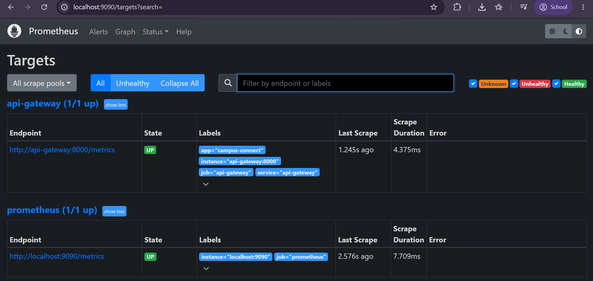

##### 4. Grafana Visual Query Panel Tracking Ingress Request Rate
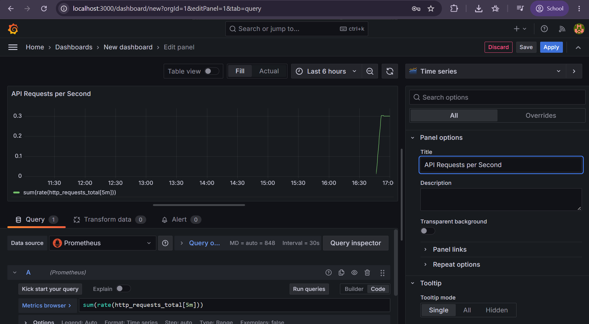

##### 5. Kubernetes Pods & User Service Scaling (3/3 Ready)
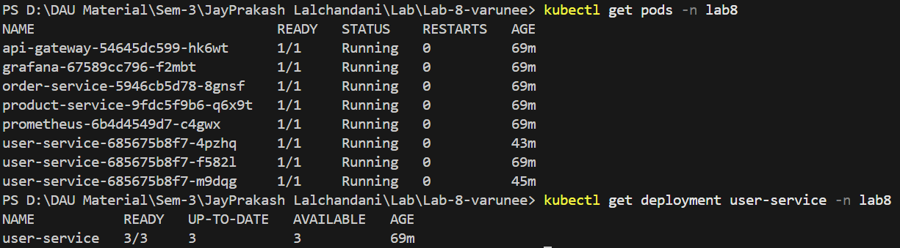

##### 6. Kubernetes Self-Healing Pod Replacement
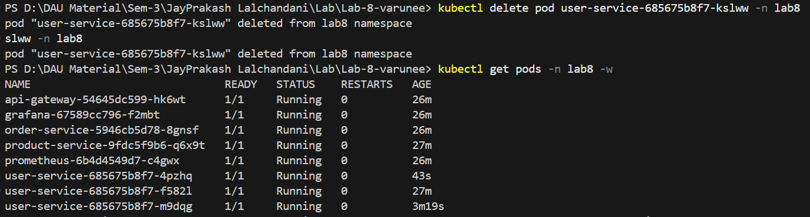

##### 7. API Gateway Live Ingress Verification (`/health` & `/users` HTTP 200)
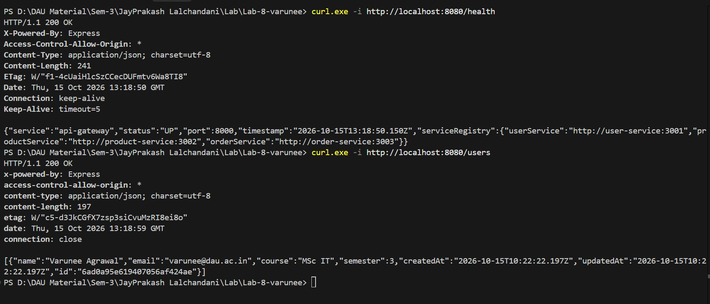

##### 8. Diagnostic Troubleshooting (Endpoints, Pod Describe & Health Probes)
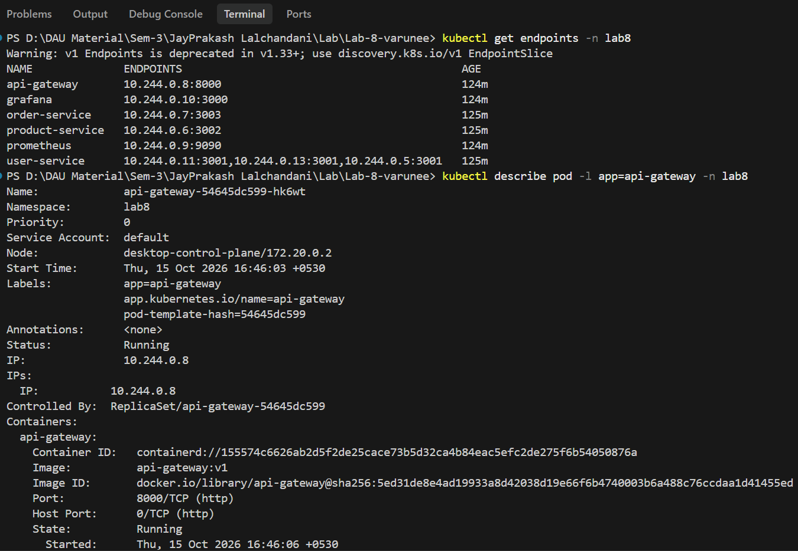

##### 9. Kubernetes Zero-Downtime Rollout to Versioned GHCR Image
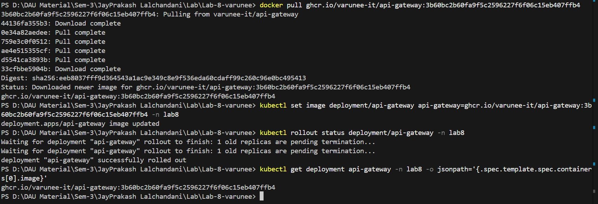

##### 10. Grafana Dashboard Baseline Before Traffic Load
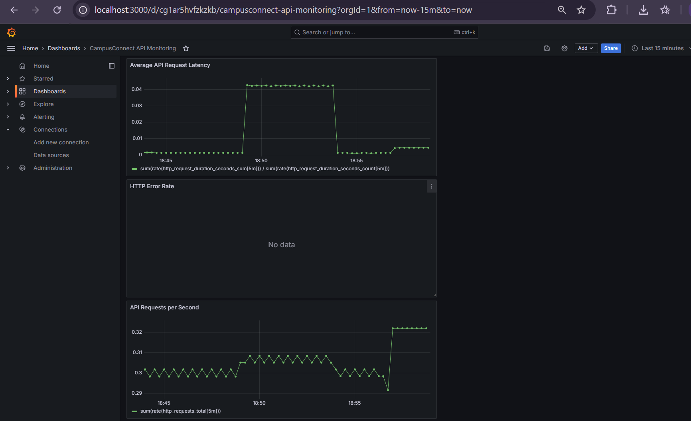

##### 11. Grafana Dashboard After Traffic Load (Rate Rises to ~0.42 req/s)
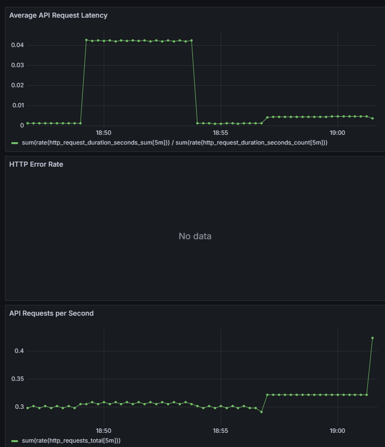

#### Evidence Filename Mapping & Integrity Checklist
To ensure full integrity between the assignment deliverables and the files saved in this repository:
- **`Screenshots/7-gateway-test.png`**: Corresponds to requested `gateway-test.png` (demonstrating two HTTP 200 gateway responses).
- **`Screenshots/8-troubleshooting.png`**: Corresponds to requested `troubleshooting.png` (demonstrating service endpoints, pod describe, readiness/liveness probes, and logs).
- **`Screenshots/9-kubernetes-rollout.png`**: Corresponds to requested `kubernetes-rollout.png` (demonstrating versioned image update, successful rollout, and final image verification).
- **`Screenshots/10-grafana-before-traffic.png`**: Corresponds to requested `7-grafana-before-traffic.png` (demonstrating baseline dashboard metrics before traffic).
- **`Screenshots/11-grafana-after-traffic.png`**: Corresponds to requested `8-grafana-after-traffic.png` (demonstrating metric rise to ~0.42 req/s following traffic).
- All 11 image files are verified to exist on disk in the `Screenshots/` directory with non-zero file sizes and valid PNG formats.

---

### 15.8 Troubleshooting & Operational Playbook

| Problem / Symptom | Root Cause | Exact Solution |
| :--- | :--- | :--- |
| **Pod Status: `Pending` or `CrashLoopBackOff`** | Liveness/readiness probe failure or missing MongoDB credentials | 1. Run `kubectl describe pod <pod-name> -n lab8` to inspect probe failure reasons.<br>2. Run `kubectl logs <pod-name> -n lab8` to check database connection logs.<br>3. Verify that `k8s/secret.yaml` was applied and contains valid Atlas connection strings. |
| **`ErrImagePull` or `ImagePullBackOff`** | Kubernetes cannot find local image or lacks registry credentials | 1. Ensure `imagePullPolicy: IfNotPresent` is set in the Deployment manifest.<br>2. If using local Docker Desktop, ensure the image exists locally via `docker images`.<br>3. If using GHCR, configure `imagePullSecrets` with a valid GitHub Personal Access Token or pull image locally with Docker first. |
| **`502 Bad Gateway` from API Gateway** | Target backend microservice is stopped, restarting, or misconfigured | 1. Check if the target service is running: `kubectl get pods -l app=user-service -n lab8`.<br>2. Verify service endpoints: `kubectl get endpoints user-service -n lab8`.<br>3. Verify ConfigMap URLs: `kubectl get configmap campus-config -n lab8 -o yaml` (must point to `http://<service-name>:<port>`). |
| **Prometheus Target Status: `DOWN`** | Prometheus cannot reach the target pod on port 8000 | 1. Verify `api-gateway` pod is Ready: `kubectl get pods -l app=api-gateway -n lab8`.<br>2. Check `api-gateway` service: `kubectl get svc api-gateway -n lab8`.<br>3. Confirm `/metrics` endpoint responds: test via `curl http://localhost:8080/metrics`. |
| **Grafana Panels Show `No data`** | No traffic during the selected time window, or query filtering on non-existent errors | 1. Change the time range in the top-right corner to `Last 15 minutes` or `Last 1 hour`.<br>2. Send API requests through the gateway (`curl http://localhost:8080/users`) to generate traffic.<br>3. For error panels, `No data` is expected when 0 errors occur; coalesce with `or vector(0)` if a continuous zero line is preferred. |
| **Port-Forward Terminated or Connection Refused** | Background `kubectl port-forward` process died or host port is busy | 1. Check running port-forward processes.<br>2. Re-run: `kubectl port-forward -n lab8 service/api-gateway 8080:8000`.<br>3. Re-run: `kubectl port-forward -n lab8 service/prometheus 9090:9090`.<br>4. Re-run: `kubectl port-forward -n lab8 service/grafana 3000:3000`. |
| **Deployment Rollout Stalled or Slow** | New container failing readiness probe or cannot pull image | 1. Check rollout status: `kubectl rollout status deployment/<name> -n lab8`.<br>2. Inspect new replica: `kubectl describe deployment <name> -n lab8`.<br>3. To undo failed rollout: `kubectl rollout undo deployment/<name> -n lab8`. |
| **Missing `k8s/secret.yaml` on New Clones** | Sensitive secret file is git-ignored to prevent credential leaks | 1. Copy template: `cp k8s/secret.yaml.example k8s/secret.yaml`.<br>2. Fill in real Atlas URIs for User, Product, and Order databases.<br>3. Apply: `kubectl apply -f k8s/secret.yaml -n lab8`. |
