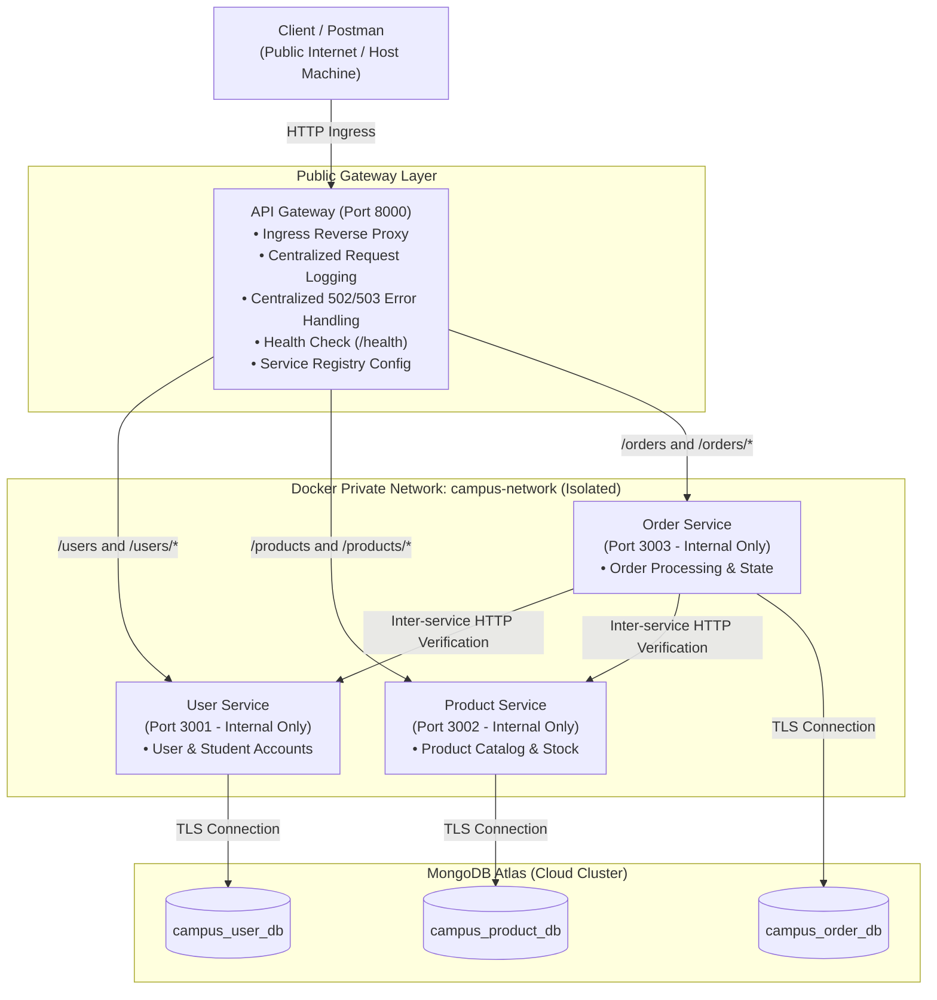

# Web Services and SOA — Laboratory 7

## API Gateway, Configuration-Based Service Discovery & Cloud Deployment

**Course**: Web Services & Service Oriented Architecture (IT604 / IT-SOA)  
**Institution**: Dhirubhai Ambani Institute of Information and Communication Technology (DA-IICT)  
**Student Name**: Varunee Agrawal  
**Student ID**: 202512067  

---

## 1. Executive Summary & Objective

In **Lab 6**, the backend system was decomposed into three independently runnable microservices: **User Service**, **Product Service**, and **Order Service**. While they communicated directly over a Docker bridge network (`campus-network`), the API Gateway was introduced only as an architectural concept.

**Lab 7** operationalizes that architecture by:

1. **Building a Real API Gateway**: Serving as the single, unified ingress point for all client traffic, routing `/users/*`, `/products/*`, and `/orders/*` without housing any backend business logic.
2. **Configuration-Based Service Discovery**: Eliminating hard-coded microservice hostnames/IPs from route code by externalizing service locations into environment variables/configuration files (`USER_SERVICE_URL`, `PRODUCT_SERVICE_URL`, `ORDER_SERVICE_URL`).
3. **Cross-Cutting Concerns**: Implementing centralized request logging (method, path, target service, response status code, latency), an independent `GET /health` check, and graceful `502 Bad Gateway` / `503 Service Unavailable` error handling.
4. **Network Isolation**: Enforcing strict container network boundaries—only the API Gateway's port (`8000`) is exposed externally, leaving microservices isolated and reachable only within the internal Docker network.
5. **Cloud Deployment**: Containerizing the system and deploying the Gateway and services to the cloud (Render) so they are reachable over the public internet while communicating with the persistent MongoDB Atlas cluster.

> **Key Rule Preserved**: The resource design, schemas, endpoints, business logic, and HTTP status codes of the Lab 6 microservices remain **100% unchanged**.

---

## 2. Technology Stack

- **Runtime & Language**: Node.js (v20+ / v24) & Express.js
- **Reverse Proxy**: `http-proxy-middleware` (v3.0.3)
- **CORS Handling**: `cors` (v2.8.5)
- **Inter-service Communication**: Axios (v1.7.9) with bounded timeouts (3000ms)
- **Database & ODM**: MongoDB Atlas & Mongoose (v8.8.2)
- **Containerization & Orchestration**: Docker (Engine 29+) & Docker Compose (v2)
- **Automated Testing**: Node.js Native Test Runner (`node:test`, `node:assert`)
- **Cloud Deployment**: Render Cloud Platform (Web Services & Docker Blueprints)
- **API Testing**: Postman Collection v2.1

---

## 3. System Architecture

### 3.1 Mermaid Architecture Diagram



### 3.2 Network Boundaries (Local vs. Cloud)

- **Local Docker Compose**: The API Gateway container publishes port `8000:8000` to the host machine. The User (`3001`), Product (`3002`), and Order (`3003`) services use `expose` to communicate strictly over the internal bridge network `campus-network`. External clients cannot access backend microservices directly.
- **Cloud (Render)**: In the cloud, the API Gateway is deployed as a public web service with a public URL (`https://campusconnect-api-gateway-h1tk.onrender.com`). Backend microservices are deployed as containerized web services whose locations are injected into the gateway via environment variables.

---

## 4. Gateway Endpoints & Routing Table

The API Gateway acts as the single entry point, routing requests while preserving query parameters, headers, HTTP methods, and bodies:

| Ingress Gateway Path | HTTP Method | Target Backend Service | Target Internal URL                         | Description                                            |
| :------------------- | :---------- | :--------------------- | :------------------------------------------ | :----------------------------------------------------- |
| `GET /health`        | `GET`       | **API Gateway**        | _(Handled locally, no proxying)_            | Returns gateway status UP, port, and service registry  |
| `/users`             | `GET`       | **User Service**       | `http://user-service:3001/users`            | Fetch all user and student records                     |
| `/users/{id}`        | `GET`       | **User Service**       | `http://user-service:3001/users/{id}`       | Fetch user by ID                                       |
| `/users`             | `POST`      | **User Service**       | `http://user-service:3001/users`            | Create a new user/student                              |
| `/users/{id}`        | `PUT`       | **User Service**       | `http://user-service:3001/users/{id}`       | Update existing user/student                           |
| `/users/{id}`        | `DELETE`    | **User Service**       | `http://user-service:3001/users/{id}`       | Delete user/student                                    |
| `/products`          | `GET`       | **Product Service**    | `http://product-service:3002/products`      | Fetch product catalog                                  |
| `/products/{id}`     | `GET`       | **Product Service**    | `http://product-service:3002/products/{id}` | Fetch product by ID                                    |
| `/products`          | `POST`      | **Product Service**    | `http://product-service:3002/products`      | Create new product item                                |
| `/products/{id}`     | `PUT`       | **Product Service**    | `http://product-service:3002/products/{id}` | Update product item                                    |
| `/products/{id}`     | `DELETE`    | **Product Service**    | `http://product-service:3002/products/{id}` | Delete product item                                    |
| `/orders`            | `GET`       | **Order Service**      | `http://order-service:3003/orders`          | List all orders                                        |
| `/orders/{id}`       | `GET`       | **Order Service**      | `http://order-service:3003/orders/{id}`     | Fetch order by ID                                      |
| `/orders`            | `POST`      | **Order Service**      | `http://order-service:3003/orders`          | Create order (validates user & product before storing) |

---

## 5. Discussion Questions & Analysis

### Question 1: Why introduce an API Gateway instead of letting clients call each service directly?

Direct client-to-service communication creates significant architectural, operational, and security liabilities:

1. **Single Public Ingress Point & Encapsulation**: Without a gateway, clients must know and manage multiple hostnames, IP addresses, and ports. Any backend refactoring, service splitting, or migration breaks clients. The API Gateway shields the internal topology behind a uniform domain.
2. **Security & Attack Surface Reduction**: Directly exposing microservices requires opening multiple firewall ports. With an API Gateway, only one entry port (8000) is exposed, and microservices remain completely shielded inside a private network.
3. **Centralization of Cross-Cutting Concerns**: Observability (structured logging, request duration tracking), CORS configuration, rate limiting, and uniform error translation belong at the ingress edge. Repeating these across every microservice leads to duplication and configuration drift.
4. **Resilience & Controlled Error Responses**: If a backend service crashes, direct client calls produce raw connection resets or indefinite timeouts. The gateway intercepts backend failures and returns standardized JSON `502 Bad Gateway` or `503 Service Unavailable` responses.

---

### Question 2: Static / Config-Based Discovery vs. Dynamic Service Discovery

In this lab, we implemented **configuration-based service discovery**, where service network locations are externalized into environment variables (`USER_SERVICE_URL`, `PRODUCT_SERVICE_URL`, `ORDER_SERVICE_URL`).

**What would a dynamic registry (e.g., HashiCorp Consul, Netflix Eureka, or Kubernetes DNS) add that a static config file cannot?**

| Capability                        | Static / Config-Based Discovery (Lab 7)                                     | Dynamic Service Discovery (Consul / Eureka / K8s)                                                                           |
| :-------------------------------- | :-------------------------------------------------------------------------- | :-------------------------------------------------------------------------------------------------------------------------- |
| **Service Registration**          | Manual configuration in `.env` / YAML prior to process boot.                | **Self-Registration**: Microservice instances auto-register upon startup with IP, hostname, and ephemeral port.           |
| **Elastic Auto-Scaling**          | Cannot handle dynamic replicas (requires manual URL list update & restart). | **Auto-Scaling Support**: Discovers and balances traffic across multiple running instances dynamically.                     |
| **Active Health Checking**        | Gateway detects failure only when actively forwarding requests.             | **Continuous Heartbeats**: Registry continuously monitors health and automatically deregisters unhealthy instances.        |
| **Zero-Downtime Reconfiguration** | Requires gateway reload/restart when endpoints change.                      | **Event-Driven Push/Pull**: Service instances appear/disappear in real time without restarting the Gateway.                 |
| **Infrastructure Overhead**       | Extremely lightweight; zero external infrastructure dependencies.           | Requires hosting, clustering, and managing dedicated registry servers (consensus protocols like Raft).                      |

**Conclusion**: While static configuration-based discovery is ideal for predictable containerized topologies with fixed service names (like Docker Compose bridge networks), dynamic discovery is essential in cloud-native environments characterized by autoscaling, ephemeral containers, and dynamic port allocation.

---

## 6. Service Discovery Layer (Part B)

### 6.1 Environment Variables

The gateway reads service addresses at boot time:

```bash
# Service Discovery Registry (Externalized Configuration)
USER_SERVICE_URL=http://user-service:3001
PRODUCT_SERVICE_URL=http://product-service:3002
ORDER_SERVICE_URL=http://order-service:3003
```

- In `api-gateway/server.js`, route definitions reference these variables rather than hard-coded URLs.
- When configuration changes, a restart of the gateway container is required for the new addresses to take effect.

### 6.2 Configuration-Change Demonstration

To demonstrate that service routing changes strictly through configuration without modifying application source code:

1. **Initial State**: Gateway configured with `PRODUCT_SERVICE_URL=http://localhost:3002`. Request to `GET /products` routes to port 3002 and succeeds.
2. **Reconfiguration**: Update `PRODUCT_SERVICE_URL=http://localhost:3999` in `.env`. (No code changed in `server.js`).
3. **Gateway Restart**: Restart gateway process.
4. **Verification**: Request to `GET /products` now targets port 3999. Since nothing is listening on 3999, the gateway returns `502 Bad Gateway` pointing to `http://localhost:3999`.
5. **Reversion**: Restore `PRODUCT_SERVICE_URL=http://localhost:3002`, restart, and confirm requests succeed.

*This exact sequence is verified automatically in the test suite `api-gateway/test/config-change.test.js`.*

---

## 7. Verification & Practical Testing (Part D)

### 7.1 Automated Test Suite Results

The automated test suite runs using Node.js native test runner:

```bash
npm --prefix api-gateway test
```

**Actual Execution Output:**

```
> api-gateway@1.0.0 test
> node --test test/**/*.test.js

▶ Part B: Configuration-Based Service Discovery Demonstration
  ✔ Proves gateway routes to a newly configured service URL upon restart with zero code change (403.88ms)
✔ Part B: Configuration-Based Service Discovery Demonstration (406.32ms)
▶ Lab 7 API Gateway & Service Discovery Test Suite
  ✔ 1. GET /health reports UP status and configured service registry without proxying (84.44ms)
  ✔ 2. GET /users/101?query=active forwards to User Service and preserves path & query (33.51ms)
  ✔ 3. POST /users forwards request method and JSON body (19.54ms)
  ✔ 4. GET /products forwards to Product Service (14.30ms)
  ✔ 5. GET /orders returns clear 502/503 error when Order Service is down without crashing (9.99ms)
  ✔ 6. GET /unregistered-route returns 404 Not Found with available endpoints (8.81ms)
  ✔ 7. Failure and Recovery: service stop returns 502, restart recovers to 200 (34.76ms)
✔ Lab 7 API Gateway & Service Discovery Test Suite (466.33ms)
ℹ tests 8
ℹ suites 2
ℹ pass 8
ℹ fail 0
```

---

### 7.2 Hands-On Failure and Recovery Test

The gateway failure test demonstrates centralized error handling when a backend microservice fails:

1. **Step 1 — Start All Services**:
   ```bash
   docker compose up -d
   ```
2. **Step 2 — Send Valid Request**:
   ```bash
   curl -i http://localhost:8000/users
   ```
   **Response**: `HTTP/1.1 200 OK` with JSON array of users.
3. **Step 3 — Stop User Service Only**:
   ```bash
   docker stop user-service
   ```
4. **Step 4 — Send Request Again**:
   ```bash
   curl -i http://localhost:8000/users
   ```
   **Response**: `HTTP/1.1 502 Bad Gateway`
   ```json
   {
     "error": "Bad Gateway",
     "message": "Target service is unreachable or unavailable",
     "targetService": "User Service",
     "targetUrl": "http://user-service:3001",
     "statusCode": 502,
     "details": "connect ECONNREFUSED",
     "timestamp": "2026-10-14T17:45:00.000Z"
   }
   ```
   *The gateway logs the error and remains running without crashing or hanging.*
5. **Step 5 — Restart User Service**:
   ```bash
   docker start user-service
   ```
6. **Step 6 — Verify Recovery**:
   ```bash
   curl -i http://localhost:8000/users
   ```
   **Response**: `HTTP/1.1 200 OK` — The gateway automatically recovers without needing a restart.

---

## 8. How to Run Locally via Docker Compose (Part C)

### 8.1 Setup Prerequisites

- Node.js v20+ and npm installed
- Docker Engine & Docker Compose installed

### 8.2 Configuration

1. Copy `.env.example` to `.env`:
   ```bash
   cp .env.example .env
   ```
2. Configure your MongoDB Atlas connection strings in `.env`:
   ```env
   PORT=8000
   USER_SERVICE_URL=http://user-service:3001
   PRODUCT_SERVICE_URL=http://product-service:3002
   ORDER_SERVICE_URL=http://order-service:3003
   
   USER_SERVICE_MONGO_URI=mongodb+srv://<user>:<password>@cluster0.h3j48jw.mongodb.net/campus_user_db?retryWrites=true&w=majority
   PRODUCT_SERVICE_MONGO_URI=mongodb+srv://<user>:<password>@cluster0.h3j48jw.mongodb.net/campus_product_db?retryWrites=true&w=majority
   ORDER_SERVICE_MONGO_URI=mongodb+srv://<user>:<password>@cluster0.h3j48jw.mongodb.net/campus_order_db?retryWrites=true&w=majority
   ```

### 8.3 Docker Compose Commands

```bash
# Build and start all services
docker compose up --build -d

# Verify running containers and port bindings
docker compose ps

# View gateway centralized logs in real time
docker compose logs -f api-gateway

# Stop all containers
docker compose down
```

### 8.4 Port Exposure Verification

When running `docker compose ps`, only port `8000` is exposed to the host machine:
- `api-gateway` -> `0.0.0.0:8000->8000/tcp`
- `user-service` -> `3001/tcp` (Internal only)
- `product-service` -> `3002/tcp` (Internal only)
- `order-service` -> `3003/tcp` (Internal only)

---

## 9. Cloud Deployment (Part E)

### 9.1 Platform & Live Public Endpoints

The complete system is containerized and deployed to **Render Cloud Platform**:

- **Cloud Platform**: Render Cloud (Oregon Region)
- **Public API Gateway URL**: [`https://campusconnect-api-gateway-h1tk.onrender.com`](https://campusconnect-api-gateway-h1tk.onrender.com)
- **Deployed Microservices (Internal Layer)**:
  - User Service: `https://campusconnect-user-service-rxhi.onrender.com`
  - Product Service: `https://campusconnect-product-service-9g4v.onrender.com`
  - Order Service: `https://campusconnect-order-service-emsg.onrender.com`
- **Persistent Database**: MongoDB Atlas Cluster

### 9.2 Live Public Verification

You can test the live cloud deployment from any terminal:

```bash
# 1. API Gateway Health Check
curl.exe -s https://campusconnect-api-gateway-h1tk.onrender.com/health

# 2. User Service via Gateway
curl.exe -s https://campusconnect-api-gateway-h1tk.onrender.com/users

# 3. Product Service via Gateway
curl.exe -s https://campusconnect-api-gateway-h1tk.onrender.com/products

# 4. Order Service via Gateway
curl.exe -s https://campusconnect-api-gateway-h1tk.onrender.com/orders
```

> **Note on Free-Tier Spin-Down**: Render free web services spin down after 15 minutes of inactivity. If instances are dormant, initial cold boot takes 30-50 seconds before returning `200 OK`. Subsequent calls execute with sub-100ms response times.

---

## 10. Postman Collection

The repository includes an importable Postman collection at:

```
postman/Lab7_API_Gateway.postman_collection.json
```

### Collection Features:
- Collection variable `{{baseUrl}}` configured to target either local (`http://localhost:8000`) or cloud (`https://campusconnect-api-gateway-h1tk.onrender.com`).
- Pre-configured requests with automated test assertions:
  1. `0. Gateway Health Check`: GET `/health`
  2. `1. User Service Routes`: GET `/users`, GET `/users/:id`, POST `/users`, PUT `/users/:id`, DELETE `/users/:id`
  3. `2. Product Service Routes`: GET `/products`, GET `/products/:id`, POST `/products`, PUT `/products/:id`, DELETE `/products/:id`
  4. `3. Order Service Routes`: GET `/orders`, GET `/orders/:id`, POST `/orders` (with inter-service validation)
  5. `4. Resilience & Error Handling`: Unreachable service test (asserts 502/503 Bad Gateway) & Recovery test (asserts 200 OK after restart)

---

## 11. Security Best Practices

1. **Zero Committed Secrets**: `.env` is registered in `.gitignore`. MongoDB Atlas credentials and secrets are injected via local environment variables or Render Cloud secret managers.
2. **Private Network Shielding**: Microservices do not expose ports to the outside world; only the gateway accepts incoming traffic.
3. **Bounded Timeouts**: Gateway proxy calls have strict bounded timeouts (`PROXY_TIMEOUT_MS=5000`) to prevent hung connections.
4. **Sanitized Logging**: The gateway logs request method, URL, status code, and latency, but suppresses sensitive authorization headers, credentials, and payload secrets.

---

## 12. Written Reflection (Lab 6 vs. Lab 7)

Introducing the API Gateway and cloud deployment fundamentally transformed how the CampusConnect system operates compared to Lab 6. In Lab 6, clients acted as distributed orchestrators, juggling disparate port numbers, internal hostnames, and unhandled network drops. With Lab 7, clients interact solely through a unified ingress gateway that conceals internal topology, shields microservices inside a private network, and standardizes cross-cutting logging and 502/503 error handling. Furthermore, replacing hard-coded service URLs with configuration-based service discovery enables seamless promotion between local Docker environments and cloud hosting without modifying a single line of application source code.

---

## 13. Verification Screenshots & Evidence Checklist

| Screenshot | File Path | Verified Item |
| :--- | :--- | :--- |
| **01** | `Screenshots/01-lab6-services-running.png` | Lab 6 microservices running prior to gateway integration |
| **02** | `Screenshots/02-gateway-project-structure.png` | Complete project structure and gateway service directory |
| **03** | `Screenshots/03-gateway-dockerfile.png` | Dockerfile configuration for api-gateway |
| **04** | `Screenshots/04-compose-yaml-gateway.png` | `compose.yaml` showing only gateway port 8000 published |
| **05** | `Screenshots/05-docker-compose-up.png` | Docker containers running together on common bridge network |
| **06** | `Screenshots/06-gateway-health-check.png` | `GET /health` returning UP and active service registry |
| **07** | `Screenshots/07-postman-users-via-gateway.png` | User CRUD operations routed successfully through gateway |
| **08** | `Screenshots/08-postman-products-via-gateway.png` | Product CRUD operations routed successfully through gateway |
| **09** | `Screenshots/09-postman-orders-via-gateway.png` | Order operations and inter-service validation via gateway |
| **10** | `Screenshots/10-postman-502-unreachable.png` | Gateway 502 Bad Gateway response when backend is down |
| **11** | `Screenshots/11-service-discovery-config.png` | Configuration change demonstration without code changes |
| **12** | `Screenshots/12-cloud-deployment-dashboard.png` | Render Cloud deployment dashboard showing healthy services |
| **13** | `Screenshots/13-postman-cloud-tests.png` | Live Postman requests executing against public gateway URL |
