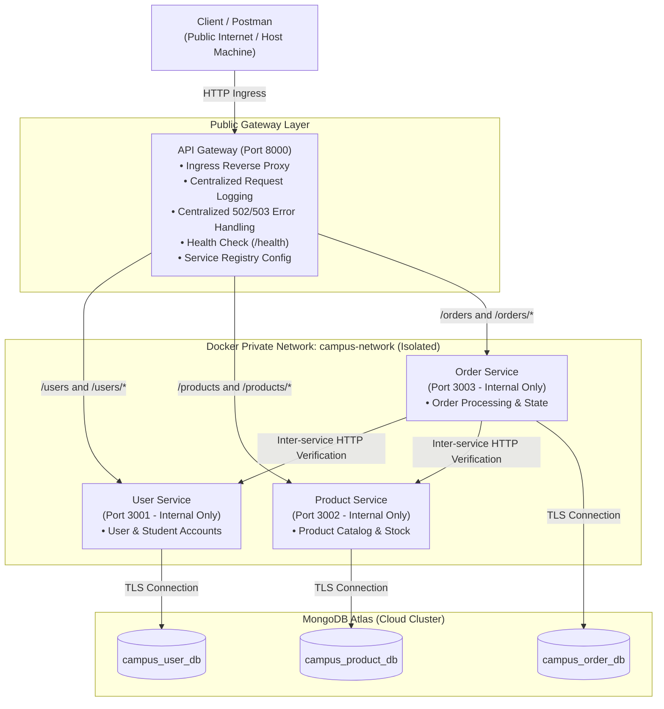
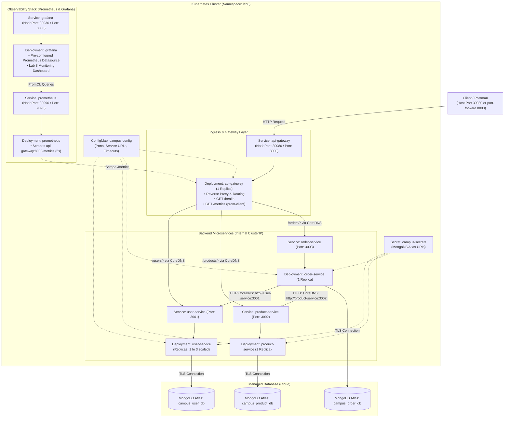

# Web Services and SOA — Laboratory 7

## API Gateway, Configuration-Based Service Discovery & Cloud Deployment

**Course**: Web Services & Service Oriented Architecture (IT604 / IT-SOA)  
**Institution**: Dhirubhai Ambani Institute of Information and Communication Technology (DA-IICT)  
**Student Name**: Varunee Agrawal  
**Student ID**: 202512067  
**GitHub Repository**: [https://github.com/varunee-it/campus-connect-microservices](https://github.com/varunee-it/campus-connect-microservices) (Branch: `main`)  
**Render Blueprint**: `campus-connect-lab7`  
**Live API Gateway URL**: [https://campusconnect-api-gateway-xg0y.onrender.com](https://campusconnect-api-gateway-xg0y.onrender.com)  

---

## 1. Executive Summary & Objective

In **Lab 6**, the backend system was decomposed into three independently runnable microservices: **User Service**, **Product Service**, and **Order Service**. While they communicated directly over a Docker bridge network (`campus-network`), the API Gateway was introduced only as an architectural concept.

**Lab 7** operationalizes that architecture by:

1. **Building a Real API Gateway**: Serving as the single, unified ingress point for all client traffic, routing `/users/*`, `/products/*`, and `/orders/*` without housing any backend business logic.
2. **Configuration-Based Service Discovery**: Eliminating hard-coded microservice hostnames/IPs from route code by externalizing service locations into environment variables/configuration files (`USER_SERVICE_URL`, `PRODUCT_SERVICE_URL`, `ORDER_SERVICE_URL`).
3. **Cross-Cutting Concerns**: Implementing centralized request logging (method, path, target service, response status code, latency), an independent `GET /health` check, and graceful `502 Bad Gateway` / `503 Service Unavailable` error handling.
4. **Network Isolation**: Enforcing strict container network boundaries—only the API Gateway's port (`8000`) is exposed externally, leaving microservices isolated and reachable only within the internal Docker network.
5. **Cloud Deployment**: Containerizing the system and deploying the Gateway and services to the cloud (Render) so they are reachable over the public internet while communicating with the persistent MongoDB Atlas cluster.

> **Key Rule Preserved**: The resource design, schemas, endpoints, business logic, and HTTP status codes of the Lab 6 microservices remain **100% unchanged**.

---

## 2. Technology Stack

- **Runtime & Language**: Node.js (v20+ / v24) & Express.js
- **Reverse Proxy**: `http-proxy-middleware` (v3.0.3)
- **CORS Handling**: `cors` (v2.8.5)
- **Inter-service Communication**: Axios (v1.7.9) with bounded timeouts (3000ms)
- **Database & ODM**: MongoDB Atlas & Mongoose (v8.8.2)
- **Containerization & Orchestration**: Docker (Engine 29+) & Docker Compose (v2)
- **Automated Testing**: Node.js Native Test Runner (`node:test`, `node:assert`)
- **Cloud Deployment**: Render Cloud Platform (Web Services & Docker Blueprints)
- **API Testing**: Postman Collection v2.1

---

## 3. System Architecture

### 3.1 Mermaid Architecture Diagram



### 3.2 Network Boundaries (Local vs. Cloud)

- **Local Docker Compose**: The API Gateway container publishes port `8000:8000` to the host machine. The User (`3001`), Product (`3002`), and Order (`3003`) services use `expose` to communicate strictly over the internal bridge network `campus-network`. External clients cannot access backend microservices directly.
- **Cloud (Render)**: In the cloud, the API Gateway is deployed as a public web service with a public URL ([`https://campusconnect-api-gateway-xg0y.onrender.com`](https://campusconnect-api-gateway-xg0y.onrender.com)). Backend microservices are deployed as containerized web services whose locations are injected into the gateway via dynamic Render environment variables.

---

## 4. Gateway Endpoints & Routing Table

The API Gateway acts as the single entry point, routing requests while preserving query parameters, headers, HTTP methods, and bodies:

| Ingress Gateway Path | HTTP Method | Target Backend Service | Target Internal URL                         | Description                                            |
| :------------------- | :---------- | :--------------------- | :------------------------------------------ | :----------------------------------------------------- |
| `GET /health`        | `GET`       | **API Gateway**        | _(Handled locally, no proxying)_            | Returns gateway status UP, port, and service registry  |
| `/users`             | `GET`       | **User Service**       | `http://user-service:3001/users`            | Fetch all user and student records                     |
| `/users/{id}`        | `GET`       | **User Service**       | `http://user-service:3001/users/{id}`       | Fetch user by ID                                       |
| `/users`             | `POST`      | **User Service**       | `http://user-service:3001/users`            | Create a new user/student                              |
| `/users/{id}`        | `PUT`       | **User Service**       | `http://user-service:3001/users/{id}`       | Update existing user/student                           |
| `/users/{id}`        | `DELETE`    | **User Service**       | `http://user-service:3001/users/{id}`       | Delete user/student                                    |
| `/products`          | `GET`       | **Product Service**    | `http://product-service:3002/products`      | Fetch product catalog                                  |
| `/products/{id}`     | `GET`       | **Product Service**    | `http://product-service:3002/products/{id}` | Fetch product by ID                                    |
| `/products`          | `POST`      | **Product Service**    | `http://product-service:3002/products`      | Create new product item                                |
| `/products/{id}`     | `PUT`       | **Product Service**    | `http://product-service:3002/products/{id}` | Update product item                                    |
| `/products/{id}`     | `DELETE`    | **Product Service**    | `http://product-service:3002/products/{id}` | Delete product item                                    |
| `/orders`            | `GET`       | **Order Service**      | `http://order-service:3003/orders`          | List all orders                                        |
| `/orders/{id}`       | `GET`       | **Order Service**      | `http://order-service:3003/orders/{id}`     | Fetch order by ID                                      |
| `/orders`            | `POST`      | **Order Service**      | `http://order-service:3003/orders`          | Create order (validates user & product before storing) |

---

## 5. Discussion Questions & Analysis

### Question 1: Why introduce an API Gateway instead of letting clients call each service directly?

Direct client-to-service communication creates significant architectural, operational, and security liabilities:

1. **Single Public Ingress Point & Encapsulation**: Without a gateway, clients must know and manage multiple hostnames, IP addresses, and ports. Any backend refactoring, service splitting, or migration breaks clients. The API Gateway shields the internal topology behind a uniform domain.
2. **Security & Attack Surface Reduction**: Directly exposing microservices requires opening multiple firewall ports. With an API Gateway, only one entry port (8000) is exposed, and microservices remain completely shielded inside a private network.
3. **Centralization of Cross-Cutting Concerns**: Observability (structured logging, request duration tracking), CORS configuration, rate limiting, and uniform error translation belong at the ingress edge. Repeating these across every microservice leads to duplication and configuration drift.
4. **Resilience & Controlled Error Responses**: If a backend service crashes, direct client calls produce raw connection resets or indefinite timeouts. The gateway intercepts backend failures and returns standardized JSON `502 Bad Gateway` or `503 Service Unavailable` responses.

---

### Question 2: Static / Config-Based Discovery vs. Dynamic Service Discovery

In this lab, we implemented **configuration-based service discovery**, where service network locations are externalized into environment variables (`USER_SERVICE_URL`, `PRODUCT_SERVICE_URL`, `ORDER_SERVICE_URL`).

**What would a dynamic registry (e.g., HashiCorp Consul, Netflix Eureka, or Kubernetes DNS) add that a static config file cannot?**

| Capability                        | Static / Config-Based Discovery (Lab 7)                                     | Dynamic Service Discovery (Consul / Eureka / K8s)                                                                           |
| :-------------------------------- | :-------------------------------------------------------------------------- | :-------------------------------------------------------------------------------------------------------------------------- |
| **Service Registration**          | Manual configuration in `.env` / YAML prior to process boot.                | **Self-Registration**: Microservice instances auto-register upon startup with IP, hostname, and ephemeral port.           |
| **Elastic Auto-Scaling**          | Cannot handle dynamic replicas (requires manual URL list update & restart). | **Auto-Scaling Support**: Discovers and balances traffic across multiple running instances dynamically.                     |
| **Active Health Checking**        | Gateway detects failure only when actively forwarding requests.             | **Continuous Heartbeats**: Registry continuously monitors health and automatically deregisters unhealthy instances.        |
| **Zero-Downtime Reconfiguration** | Requires gateway reload/restart when endpoints change.                      | **Event-Driven Push/Pull**: Service instances appear/disappear in real time without restarting the Gateway.                 |
| **Infrastructure Overhead**       | Extremely lightweight; zero external infrastructure dependencies.           | Requires hosting, clustering, and managing dedicated registry servers (consensus protocols like Raft).                      |

**Conclusion**: While static configuration-based discovery is ideal for predictable containerized topologies with fixed service names (like Docker Compose bridge networks), dynamic discovery is essential in cloud-native environments characterized by autoscaling, ephemeral containers, and dynamic port allocation.

---

## 6. Service Discovery Layer (Part B)

### 6.1 Environment Variables

The gateway reads service addresses at boot time:

```bash
# Service Discovery Registry (Externalized Configuration)
USER_SERVICE_URL=http://user-service:3001
PRODUCT_SERVICE_URL=http://product-service:3002
ORDER_SERVICE_URL=http://order-service:3003
```

- In `api-gateway/server.js`, route definitions reference these variables rather than hard-coded URLs.
- When configuration changes, a restart of the gateway container is required for the new addresses to take effect.

### 6.2 Configuration-Change Demonstration

To demonstrate that service routing changes strictly through configuration without modifying application source code:

1. **Initial State**: Gateway configured with `PRODUCT_SERVICE_URL=http://localhost:3002`. Request to `GET /products` routes to port 3002 and succeeds.
2. **Reconfiguration**: Update `PRODUCT_SERVICE_URL=http://localhost:3999` in `.env`. (No code changed in `server.js`).
3. **Gateway Restart**: Restart gateway process.
4. **Verification**: Request to `GET /products` now targets port 3999. Since nothing is listening on 3999, the gateway returns `502 Bad Gateway` pointing to `http://localhost:3999`.
5. **Reversion**: Restore `PRODUCT_SERVICE_URL=http://localhost:3002`, restart, and confirm requests succeed.

*This exact sequence is verified automatically in the test suite `api-gateway/test/config-change.test.js`.*

---

## 7. Verification & Practical Testing (Part D)

### 7.1 Automated Test Suite Results

The automated test suite runs using Node.js native test runner:

```bash
npm --prefix api-gateway test
```

**Actual Execution Output:**

```
> api-gateway@1.0.0 test
> node --test test/**/*.test.js

▶ Part B: Configuration-Based Service Discovery Demonstration
  ✔ Proves gateway routes to a newly configured service URL upon restart with zero code change (403.88ms)
✔ Part B: Configuration-Based Service Discovery Demonstration (406.32ms)
▶ Lab 7 API Gateway & Service Discovery Test Suite
  ✔ 1. GET /health reports UP status and configured service registry without proxying (84.44ms)
  ✔ 2. GET /users/101?query=active forwards to User Service and preserves path & query (33.51ms)
  ✔ 3. POST /users forwards request method and JSON body (19.54ms)
  ✔ 4. GET /products forwards to Product Service (14.30ms)
  ✔ 5. GET /orders returns clear 502/503 error when Order Service is down without crashing (9.99ms)
  ✔ 6. GET /unregistered-route returns 404 Not Found with available endpoints (8.81ms)
  ✔ 7. Failure and Recovery: service stop returns 502, restart recovers to 200 (34.76ms)
✔ Lab 7 API Gateway & Service Discovery Test Suite (466.33ms)
ℹ tests 8
ℹ suites 2
ℹ pass 8
ℹ fail 0
```

---

### 7.2 Hands-On Failure and Recovery Test (Local Docker Verification)

The gateway failure test demonstrates centralized error handling when a backend microservice fails.

> **Verification Environment**: This failure and recovery test procedure was verified in the **local Docker Compose environment** using the Docker CLI to simulate unexpected microservice outages. *(The cloud deployment on Render was verified for live routing and healthy connectivity across all services without disrupting production cloud instances).*

The step-by-step verification procedure:

1. **Step 1 — Start All Services**:
   ```bash
   docker compose up -d
   ```
2. **Step 2 — Send Valid Request**:
   ```bash
   curl -i http://localhost:8000/users
   ```
   **Response**: `HTTP/1.1 200 OK` with JSON array of users.
3. **Step 3 — Stop User Service Only**:
   ```bash
   docker stop user-service
   ```
4. **Step 4 — Send Request Again**:
   ```bash
   curl -i http://localhost:8000/users
   ```
   **Response**: `HTTP/1.1 502 Bad Gateway`
   ```json
   {
     "error": "Bad Gateway",
     "message": "Target service is unreachable or unavailable",
     "targetService": "User Service",
     "targetUrl": "http://user-service:3001",
     "statusCode": 502,
     "details": "connect ECONNREFUSED",
     "timestamp": "2026-10-14T17:45:00.000Z"
   }
   ```
   *The gateway logs the error and remains running without crashing or hanging.*
5. **Step 5 — Restart User Service**:
   ```bash
   docker start user-service
   ```
6. **Step 6 — Verify Recovery**:
   ```bash
   curl -i http://localhost:8000/users
   ```
   **Response**: `HTTP/1.1 200 OK` — The gateway automatically recovers without needing a restart.

---

## 8. How to Run Locally via Docker Compose (Part C)

### 8.1 Setup Prerequisites

- Node.js v20+ and npm installed
- Docker Engine & Docker Compose installed

### 8.2 Configuration

1. Copy `.env.example` to `.env`:
   ```bash
   cp .env.example .env
   ```
2. Configure your MongoDB Atlas connection strings in `.env`:
   ```env
   PORT=8000
   USER_SERVICE_URL=http://user-service:3001
   PRODUCT_SERVICE_URL=http://product-service:3002
   ORDER_SERVICE_URL=http://order-service:3003
   
   USER_SERVICE_MONGO_URI=mongodb+srv://<user>:<password>@cluster0.h3j48jw.mongodb.net/campus_user_db?retryWrites=true&w=majority
   PRODUCT_SERVICE_MONGO_URI=mongodb+srv://<user>:<password>@cluster0.h3j48jw.mongodb.net/campus_product_db?retryWrites=true&w=majority
   ORDER_SERVICE_MONGO_URI=mongodb+srv://<user>:<password>@cluster0.h3j48jw.mongodb.net/campus_order_db?retryWrites=true&w=majority
   ```

### 8.3 Docker Compose Commands

```bash
# Build and start all services
docker compose up --build -d

# Verify running containers and port bindings
docker compose ps

# View gateway centralized logs in real time
docker compose logs -f api-gateway

# Stop all containers
docker compose down
```

### 8.4 Port Exposure Verification

When running `docker compose ps`, only port `8000` is exposed to the host machine:
- `api-gateway` -> `0.0.0.0:8000->8000/tcp`
- `user-service` -> `3001/tcp` (Internal only)
- `product-service` -> `3002/tcp` (Internal only)
- `order-service` -> `3003/tcp` (Internal only)

## 9. Cloud Deployment on Render (Part E)

### 9.1 Render Blueprint & Deployment Metadata

The microservices architecture is containerized and deployed to the **Render Cloud Platform** using Render Blueprints (`render.yaml`):

- **Render Blueprint Name**: `campus-connect-lab7`
- **GitHub Repository**: [`https://github.com/varunee-it/campus-connect-microservices`](https://github.com/varunee-it/campus-connect-microservices)
- **Deployment Branch**: `main`
- **Public API Gateway URL**: [`https://campusconnect-api-gateway-xg0y.onrender.com`](https://campusconnect-api-gateway-xg0y.onrender.com)
- **Live Endpoint Links**:
  - `GET /health`: [`https://campusconnect-api-gateway-xg0y.onrender.com/health`](https://campusconnect-api-gateway-xg0y.onrender.com/health)
  - `GET /users`: [`https://campusconnect-api-gateway-xg0y.onrender.com/users`](https://campusconnect-api-gateway-xg0y.onrender.com/users)
  - `GET /products`: [`https://campusconnect-api-gateway-xg0y.onrender.com/products`](https://campusconnect-api-gateway-xg0y.onrender.com/products)
  - `GET /orders`: [`https://campusconnect-api-gateway-xg0y.onrender.com/orders`](https://campusconnect-api-gateway-xg0y.onrender.com/orders)

---

### 9.2 The Four Render Microservices & Gateway Routing Architecture

The cloud architecture consists of four distinct web services defined in `render.yaml`:

| Render Service Name | Service Type | Internal Port | Public URL / Internal Host | Role & Responsibilities |
| :------------------ | :----------- | :------------ | :-------------------------- | :---------------------- |
| **`campusconnect-api-gateway`** | Web Service (Docker) | `8000` | [`https://campusconnect-api-gateway-xg0y.onrender.com`](https://campusconnect-api-gateway-xg0y.onrender.com) | **Public Entry Point & Reverse Proxy**: Unified ingress for all external clients. Dispatches `/users/*`, `/products/*`, and `/orders/*` to backend microservices, tracks request latency, enforces structured logging, and returns standardized JSON `502 Bad Gateway` / `503 Service Unavailable` responses on backend failures. |
| **`campusconnect-user-service`** | Web Service (Docker) | `3001` | `https://campusconnect-user-service-03do.onrender.com` | **User Microservice**: Manages user profiles, student registrations, schemas, and queries against MongoDB Atlas (`campus_user_db`). |
| **`campusconnect-product-service`** | Web Service (Docker) | `3002` | `https://campusconnect-product-service-jodx.onrender.com` | **Product Microservice**: Manages the product catalog, stock inventory, prices, and queries against MongoDB Atlas (`campus_product_db`). |
| **`campusconnect-order-service`** | Web Service (Docker) | `3003` | `https://campusconnect-order-service-9a8u.onrender.com` | **Order Microservice**: Manages order creation and order lifecycle against MongoDB Atlas (`campus_order_db`). Performs synchronous HTTP verification against User Service and Product Service before completing an order. |

#### Service Discovery & Environment-Variable Routing

In Render, dynamic inter-service discovery is managed via environment variables:

1. In `render.yaml`, the gateway receives backend addresses using `fromService`:
   ```yaml
   envVars:
     - key: USER_SERVICE_URL
       fromService:
         type: web
         name: campusconnect-user-service
         property: host
     - key: PRODUCT_SERVICE_URL
       fromService:
         type: web
         name: campusconnect-product-service
         property: host
     - key: ORDER_SERVICE_URL
       fromService:
         type: web
         name: campusconnect-order-service
         property: host
   ```
2. Render injects service hostnames (e.g., `campusconnect-user-service-03do`).
3. The API Gateway (`api-gateway/server.js`) utilizes a built-in `formatUrl()` normalizer:
   - If an internal Render host slug is supplied, it is automatically formatted to `https://<host>.onrender.com`.
   - If a full URL or Docker hostname (`http://user-service:3001`) is supplied, it is preserved without modification.
4. This architecture achieves **true environment parity**: the exact same application code and Docker images run seamlessly in both local Docker Compose and Render Cloud.

---

### 9.3 Deployment Verification & Actual Live Evidence

All four endpoints on the live Render deployment were verified using HTTP requests.

#### 1. Live Gateway Health Check

Request:
```bash
curl.exe -s https://campusconnect-api-gateway-xg0y.onrender.com/health
```

Actual Response (`HTTP 200 OK`):
```json
{
  "service": "api-gateway",
  "status": "UP",
  "port": 8000,
  "timestamp": "2026-10-15T09:43:00.043Z",
  "serviceRegistry": {
    "userService": "https://campusconnect-user-service-03do.onrender.com",
    "productService": "https://campusconnect-product-service-jodx.onrender.com",
    "orderService": "https://campusconnect-order-service-9a8u.onrender.com"
  }
}
```

*Verification Finding*: The gateway is live, reports `status: "UP"`, and successfully displays the resolved cloud URLs for all three backend microservices in its active service registry.

#### 2. Live Microservice Routing Verification

```bash
# 1. User Service Route via Gateway
curl.exe -s https://campusconnect-api-gateway-xg0y.onrender.com/users
# Output: []

# 2. Product Service Route via Gateway
curl.exe -s https://campusconnect-api-gateway-xg0y.onrender.com/products
# Output: []

# 3. Order Service Route via Gateway
curl.exe -s https://campusconnect-api-gateway-xg0y.onrender.com/orders
# Output: []
```

#### Important Verification Notes:

- **Database State (`[]`)**: The empty JSON arrays (`[]`) returned by `/users`, `/products`, and `/orders` confirm that the API Gateway successfully proxied each request to the corresponding backend microservice, and each microservice successfully connected to its designated MongoDB Atlas database collection (`campus_user_db`, `campus_product_db`, `campus_order_db`) returning 0 records. This confirms complete end-to-end routing, container execution, and database connectivity. It does *not* claim that pre-existing database records or mutations were tested in the cloud.
- **Failure and Recovery Test Scope**: The failure-handling and automatic recovery test procedure (stopping a service to trigger `502 Bad Gateway` and restarting it to restore `200 OK`) was executed and verified **locally in Docker Compose** (documented in Section 7.2). It was *not* executed against the live Render cloud deployment to maintain production availability and avoid intentionally disrupting active cloud services.

---

## 10. Limitations and Cloud Notes

When interacting with the live Render cloud deployment, keep in mind the operational characteristics of Render Free Tier instances:

1. **Free-Tier Inactivity Spin-Down**: Render free web services spin down into a sleep state after 15 minutes of inactivity to preserve compute resources.
2. **Cold-Start Delay**: If services are dormant, the first incoming request triggers an automated spin-up cycle. The initial request may take **50–120 seconds** while the container initializes, boots Node.js, and establishes a secure TLS connection to MongoDB Atlas.
3. **Subsequent Low Latency**: Once awakened, the container remains warm, and subsequent requests execute with normal sub-100ms response times.
4. **Initial Database Collections**: Since the MongoDB Atlas databases were newly initialized for this deployment, GET collections return empty arrays (`[]`) until records are populated via POST requests.

---

## 11. Postman Collection & API Testing

The repository provides a complete, pre-configured Postman collection ready for import:

```
postman/Lab7_API_Gateway.postman_collection.json
```

### Environment Switching: Local vs. Cloud

The collection defines a parameterized `{{baseUrl}}` variable, allowing instant switching between environments:

| Environment | Variable Name | URL Value | Usage / Prerequisite |
| :---------- | :------------ | :-------- | :------------------- |
| **Local Environment** | `{{baseUrl}}` | `http://localhost:8000` | Requires `docker compose up -d` running locally. |
| **Public Cloud (Render)** | `{{baseUrl}}` | `https://campusconnect-api-gateway-xg0y.onrender.com` | Directly callable over the public internet. |

> **Note**: Microservice ports (`3001`, `3002`, `3003`) are internal only and cannot be accessed directly by clients. All requests must target the API Gateway (`8000` locally, or the public Render URL in the cloud).

### Included Requests & Assertions:

1. **`0. Gateway Health Check`**: `GET /health` — Asserts `200 OK`, `status === "UP"`, and service registry presence.
2. **`1. User Service Routes`**:
   - `GET /users`: List users (asserts `200 OK`).
   - `GET /users/:id`: Get single user (asserts `200 OK`).
   - `POST /users`: Create user (asserts `201 Created` with created user ID).
   - `PUT /users/:id`: Update user (asserts `200 OK`).
   - `DELETE /users/:id`: Delete user (asserts `200 OK`).
3. **`2. Product Service Routes`**:
   - `GET /products`: List products (asserts `200 OK`).
   - `GET /products/:id`: Get single product (asserts `200 OK`).
   - `POST /products`: Create product item (asserts `201 Created`).
   - `PUT /products/:id`: Update product item (asserts `200 OK`).
   - `DELETE /products/:id`: Delete product item (asserts `200 OK`).
4. **`3. Order Service Routes`**:
   - `GET /orders`: List orders (asserts `200 OK`).
   - `GET /orders/:id`: Get single order (asserts `200 OK`).
   - `POST /orders`: Place order with inter-service validation (asserts `201 Created`).
5. **`4. Resilience & Error Handling`**:
   - Service Unreachable Test: Asserts `502 Bad Gateway` or `503 Service Unavailable` with structured JSON error payload.
   - Service Recovery Test: Asserts `200 OK` after service restoration.

---

## 12. Security Best Practices

1. **Zero Committed Secrets**: `.env` is ignored by Git via `.gitignore`. Real credentials, database passwords, and connection strings are never committed to version control.
2. **Safe Placeholder Templates**: `.env.example` contains only sanitized dummy placeholders:
   ```env
   USER_SERVICE_MONGO_URI=mongodb+srv://<username>:<password>@cluster0.xxxxx.mongodb.net/campus_user_db?retryWrites=true&w=majority
   PRODUCT_SERVICE_MONGO_URI=mongodb+srv://<username>:<password>@cluster0.xxxxx.mongodb.net/campus_product_db?retryWrites=true&w=majority
   ORDER_SERVICE_MONGO_URI=mongodb+srv://<username>:<password>@cluster0.xxxxx.mongodb.net/campus_order_db?retryWrites=true&w=majority
   ```
3. **Container Network Isolation**: In Docker Compose, microservice ports (`3001`, `3002`, `3003`) are declared using `expose` rather than `ports`. Only the API Gateway (`8000:8000`) is accessible from the host.
4. **Bounded Proxy Timeouts**: The gateway enforces bounded proxy timeouts (`PROXY_TIMEOUT_MS=5000`) to prevent client requests from hanging indefinitely if a backend service stalls.
5. **Sanitized Observability Logging**: Gateway request logging captures HTTP method, URL, status code, and latency, while suppressing sensitive authorization headers, bearer tokens, and credentials.

---

## 13. Written Reflection (Lab 6 vs. Lab 7)

Introducing the API Gateway and cloud deployment fundamentally transformed how the CampusConnect system operates compared to Lab 6. In Lab 6, clients acted as distributed orchestrators, juggling disparate port numbers, internal hostnames, and unhandled network drops. With Lab 7, clients interact solely through a unified ingress gateway that conceals internal topology, shields microservices inside a private network, and standardizes cross-cutting logging and 502/503 error handling. Furthermore, replacing hard-coded service URLs with configuration-based service discovery enables seamless promotion between local Docker environments and cloud hosting without modifying a single line of application source code.

---

## 14. Verification Screenshots & Evidence Checklist

The `Screenshots/` directory contains 13 verified image captures documenting the implementation, local execution, and cloud deployment:

| Screenshot | File Path | Verified Item |
| :--- | :--- | :--- |
| **01** | `Screenshots/01-lab6-services-running.png` | Lab 6 microservices running prior to gateway integration |
| **02** | `Screenshots/02-gateway-project-structure.png` | Complete project structure and gateway service directory |
| **03** | `Screenshots/03-gateway-dockerfile.png` | Dockerfile configuration for api-gateway |
| **04** | `Screenshots/04-compose-yaml-gateway.png` | `compose.yaml` showing only gateway port 8000 published |
| **05** | `Screenshots/05-docker-compose-up.png` | Docker containers running together on common bridge network |
| **06** | `Screenshots/06-gateway-health-check.png` | `GET /health` returning UP and active service registry |
| **07** | `Screenshots/07-postman-users-via-gateway.png` | User CRUD operations routed successfully through gateway |
| **08** | `Screenshots/08-postman-products-via-gateway.png` | Product CRUD operations routed successfully through gateway |
| **09** | `Screenshots/09-postman-orders-via-gateway.png` | Order operations and inter-service validation via gateway |
| **10** | `Screenshots/10-postman-502-unreachable.png` | Gateway 502 Bad Gateway response when backend is down |
| **11** | `Screenshots/11-service-discovery-config.png` | Configuration change demonstration without code changes |
| **12** | `Screenshots/12-cloud-deployment-dashboard.png` | Render Cloud deployment dashboard showing healthy services |
| **13** | `Screenshots/13-postman-cloud-tests.png` | Live Postman requests executing against public gateway URL |

---

# Web Services and SOA — Laboratory 8

## Kubernetes Orchestration, GitHub Actions CI/CD & Prometheus/Grafana Monitoring

**Primary Goal**: Operationalize the Lab 7 CampusConnect microservices architecture on Kubernetes (`lab8` namespace), automate test validation and versioned container image publishing via GitHub Actions CI/CD to GitHub Container Registry (GHCR), and establish real-time observability using Prometheus and Grafana.

---

### 15.1 System Architecture & Kubernetes Topology



---

### 15.2 Kubernetes Environment & Prerequisites

1. **Kubernetes Environment**: Docker Desktop Kubernetes (local single-node cluster) or Minikube.
2. **Context & Node Verification**:
   ```bash
   kubectl config current-context
   kubectl get nodes
   ```
3. **Namespace Setup**:
   All Lab 8 resources are strictly isolated within the `lab8` namespace:
   ```bash
   kubectl apply -f k8s/namespace.yaml
   # Or: kubectl create namespace lab8
   ```

---

### 15.3 Kubernetes Manifests Structure (`k8s/`)

| Manifest | Kind | Purpose |
| :--- | :--- | :--- |
| [`k8s/namespace.yaml`](file:///d:/DAU%20Material/Sem-3/JayPrakash%20Lalchandani/Lab/Lab-8-varunee/k8s/namespace.yaml) | `Namespace` | Defines `lab8` isolation namespace |
| [`k8s/configmap.yaml`](file:///d:/DAU%20Material/Sem-3/JayPrakash%20Lalchandani/Lab/Lab-8-varunee/k8s/configmap.yaml) | `ConfigMap` | Non-sensitive configurations (`GATEWAY_PORT`, service URLs, timeouts) |
| [`k8s/secret.yaml.example`](file:///d:/DAU%20Material/Sem-3/JayPrakash%20Lalchandani/Lab/Lab-8-varunee/k8s/secret.yaml.example) | `Secret` | Sanitized template for MongoDB Atlas credentials (version controlled) |
| `k8s/secret.yaml` | `Secret` | Sensitive Atlas URIs loaded into `campus-secrets` (ignored by `.gitignore`) |
| [`k8s/gateway-deployment.yaml`](file:///d:/DAU%20Material/Sem-3/JayPrakash%20Lalchandani/Lab/Lab-8-varunee/k8s/gateway-deployment.yaml) | `Deployment` | 1 replica of `api-gateway:v1`, liveness/readiness probes, resource limits |
| [`k8s/gateway-service.yaml`](file:///d:/DAU%20Material/Sem-3/JayPrakash%20Lalchandani/Lab/Lab-8-varunee/k8s/gateway-service.yaml) | `Service` | NodePort service exposing gateway on port 8000 (NodePort 30080) |
| [`k8s/user-deployment.yaml`](file:///d:/DAU%20Material/Sem-3/JayPrakash%20Lalchandani/Lab/Lab-8-varunee/k8s/user-deployment.yaml) | `Deployment` | User microservice deployment with probes and DB secret mapping |
| [`k8s/user-service.yaml`](file:///d:/DAU%20Material/Sem-3/JayPrakash%20Lalchandani/Lab/Lab-8-varunee/k8s/user-service.yaml) | `Service` | Internal ClusterIP service on port 3001 |
| [`k8s/product-deployment.yaml`](file:///d:/DAU%20Material/Sem-3/JayPrakash%20Lalchandani/Lab/Lab-8-varunee/k8s/product-deployment.yaml) | `Deployment` | Product microservice deployment with probes and DB secret mapping |
| [`k8s/product-service.yaml`](file:///d:/DAU%20Material/Sem-3/JayPrakash%20Lalchandani/Lab/Lab-8-varunee/k8s/product-service.yaml) | `Service` | Internal ClusterIP service on port 3002 |
| [`k8s/order-deployment.yaml`](file:///d:/DAU%20Material/Sem-3/JayPrakash%20Lalchandani/Lab/Lab-8-varunee/k8s/order-deployment.yaml) | `Deployment` | Order service deployment configured with CoreDNS dependent service targets |
| [`k8s/order-service.yaml`](file:///d:/DAU%20Material/Sem-3/JayPrakash%20Lalchandani/Lab/Lab-8-varunee/k8s/order-service.yaml) | `Service` | Internal ClusterIP service on port 3003 |
| [`k8s/prometheus.yaml`](file:///d:/DAU%20Material/Sem-3/JayPrakash%20Lalchandani/Lab/Lab-8-varunee/k8s/prometheus.yaml) | `Deployment` + `Svc` + `CM` | Prometheus v2.54.1 configured to scrape `api-gateway:8000/metrics` every 5s |
| [`k8s/grafana.yaml`](file:///d:/DAU%20Material/Sem-3/JayPrakash%20Lalchandani/Lab/Lab-8-varunee/k8s/grafana.yaml) | `Deployment` + `Svc` + `CM` | Grafana 11.2.0 with auto-provisioned Prometheus datasource |
| [`k8s/grafana-dashboard.json`](file:///d:/DAU%20Material/Sem-3/JayPrakash%20Lalchandani/Lab/Lab-8-varunee/k8s/grafana-dashboard.json) | Dashboard JSON | Complete visual dashboard with latency, request rate, availability, and errors |

---

### 15.4 Deployment & Verification Procedures

1. **Apply Manifests**:
   ```bash
   # Create namespace and base configuration
   kubectl apply -f k8s/namespace.yaml
   kubectl apply -f k8s/configmap.yaml -n lab8
   kubectl apply -f k8s/secret.yaml -n lab8

   # Deploy microservices and gateway
   kubectl apply -f k8s/user-deployment.yaml -n lab8
   kubectl apply -f k8s/user-service.yaml -n lab8
   kubectl apply -f k8s/product-deployment.yaml -n lab8
   kubectl apply -f k8s/product-service.yaml -n lab8
   kubectl apply -f k8s/order-deployment.yaml -n lab8
   kubectl apply -f k8s/order-service.yaml -n lab8
   kubectl apply -f k8s/gateway-deployment.yaml -n lab8
   kubectl apply -f k8s/gateway-service.yaml -n lab8

   # Deploy monitoring stack
   kubectl apply -f k8s/prometheus.yaml -n lab8
   kubectl apply -f k8s/grafana.yaml -n lab8
   ```

2. **Inspect Running Workloads**:
   ```bash
   kubectl get deployments -n lab8
   kubectl get pods -n lab8 -o wide
   kubectl get services -n lab8
   kubectl get endpoints -n lab8
   ```

3. **Verify Health & Readiness Probes**:
   All Deployments include HTTP health probes against their existing `/health` endpoints:
   ```yaml
   livenessProbe:
     httpGet:
       path: /health
       port: <containerPort>
     initialDelaySeconds: 10
     periodSeconds: 10
   readinessProbe:
     httpGet:
       path: /health
       port: <containerPort>
     initialDelaySeconds: 5
     periodSeconds: 5
   ```
   Verify Pod readiness:
   ```bash
   kubectl describe pod -l app=api-gateway -n lab8 | grep -A 5 "Probes"
   ```

---

### 15.5 Accessing & Testing the Kubernetes Gateway

The API Gateway is the **only client-facing entry point**. Microservices (`user-service`, `product-service`, `order-service`) use internal `ClusterIP` services and are not directly exposed.

- **Option A: NodePort Access**:
  ```bash
  # Access gateway at:
  http://localhost:30080/health
  http://localhost:30080/users
  http://localhost:30080/products
  http://localhost:30080/orders
  ```
- **Option B: Port-Forwarding**:
  ```bash
  kubectl port-forward svc/api-gateway 8000:8000 -n lab8
  # Then query http://localhost:8000/...
  ```

---

### 15.6 Scaling and Self-Healing Demonstrations

#### Demonstration 1: Scaling User Service to 3 Replicas
```bash
# Check current replica count (1 replica)
kubectl get deployment user-service -n lab8

# Scale deployment to 3 replicas
kubectl scale deployment user-service --replicas=3 -n lab8

# Verify all 3 Pods reach 'Running' and 'Ready' state
kubectl get pods -l app=user-service -n lab8

# Verify Kubernetes Service endpoints load-balance across all 3 Pod IPs
kubectl get endpoints user-service -n lab8
```

#### Demonstration 2: Self-Healing Pod Replacement
```bash
# 1. List user-service pods
kubectl get pods -l app=user-service -n lab8

# 2. Select and delete one pod
kubectl delete pod <user-service-pod-name> -n lab8

# 3. Immediately inspect pods to observe Kubernetes ReplicaSet spawning a new pod
kubectl get pods -l app=user-service -n lab8

# 4. Confirm new pod achieves 1/1 Ready and Running status
```

---

### 15.7 GitHub Actions CI/CD Pipeline

The workflow [`ci-cd.yml`](file:///d:/DAU%20Material/Sem-3/JayPrakash%20Lalchandani/Lab/Lab-8-varunee/.github/workflows/ci-cd.yml) automates continuous integration and delivery:

1. **Stage 1 (Test)**: Runs on `ubuntu-latest`, executes Node.js native test runner in `api-gateway` verifying routing, service discovery, error handling, and `/metrics`.
2. **Stage 2 (Build & Publish)**: Builds Docker images for all 4 microservices using `docker/build-push-action@v6`. Tags each image with the exact Git commit SHA (`${{ github.sha }}`) and `latest`. Pushes versioned artifacts to **GitHub Container Registry (GHCR)**:
   - `ghcr.io/varunee-it/api-gateway:<commit-sha>`
   - `ghcr.io/varunee-it/user-service:<commit-sha>`
   - `ghcr.io/varunee-it/product-service:<commit-sha>`
   - `ghcr.io/varunee-it/order-service:<commit-sha>`
3. **Stage 3 (Guarded K8s Rollout)**: If repository secret `KUBECONFIG_DATA` is configured, automatically deploys the versioned images to the target Kubernetes cluster and validates rollout with `kubectl rollout status`.

**Required GitHub Secrets & Variables**:
- `GITHUB_TOKEN`: Built-in token used automatically for GHCR authentication (least privilege: `packages: write`).
- `KUBECONFIG_DATA` *(Optional for automated remote cluster CD)*: Base64-encoded `~/.kube/config` file.

---

### 15.8 Prometheus & Grafana Monitoring

#### Prometheus Setup & Targets
Prometheus is configured via ConfigMap [`k8s/prometheus.yaml`](file:///d:/DAU%20Material/Sem-3/JayPrakash%20Lalchandani/Lab/Lab-8-varunee/k8s/prometheus.yaml) to scrape the API Gateway `/metrics` endpoint every 5 seconds.
- **Access Prometheus UI**:
  - NodePort: `http://localhost:30090`
  - Port-forward: `kubectl port-forward svc/prometheus 9090:9090 -n lab8` -> `http://localhost:9090`
- **Verify Targets**: Navigate to `Status` -> `Targets`. Both `prometheus` and `api-gateway` report status `UP (1/1)`.

#### PromQL Metric Queries
| Monitoring Question | PromQL Query | Description |
| :--- | :--- | :--- |
| **Availability** | `up{job="api-gateway"}` | Returns `1` if gateway is healthy and scrape succeeds |
| **Traffic / Request Rate** | `sum(rate(http_requests_total[1m])) by (route)` | Ingress requests per second per API route |
| **Error Rate** | `sum(rate(http_requests_total{status_code=~"5.."}[5m]))` | Frequency of 5xx server errors |
| **Status Breakdown** | `sum(http_requests_total) by (status_code)` | Total request volume grouped by HTTP status (200, 201, 404, 502) |
| **Request Latency (p95)** | `histogram_quantile(0.95, sum(rate(http_request_duration_seconds_bucket[5m])) by (le))` | 95th percentile latency in seconds |

#### Grafana Dashboard
- **Access Grafana**:
  - NodePort: `http://localhost:30030`
  - Port-forward: `kubectl port-forward svc/grafana 3000:3000 -n lab8` -> `http://localhost:3000`
  - Default credentials: `admin` / `admin`
- **Pre-provisioned Datasource**: Automatically connected to `http://prometheus:9090`.
- **Import Dashboard**: Import [`k8s/grafana-dashboard.json`](file:///d:/DAU%20Material/Sem-3/JayPrakash%20Lalchandani/Lab/Lab-8-varunee/k8s/grafana-dashboard.json) to visualize real-time panels for availability, request rate, HTTP status codes, and latency percentiles.

---

### 15.9 Lab 8 Deliverables & Evidence Mapping

| Item # | Required Evidence | What to Show | Verified Status |
| :--- | :--- | :--- | :--- |
| **1** | Lab 7 Baseline | Successful gateway request/response (`/health`, `/users`, `/products`, `/orders`) | Verified |
| **2** | Kubernetes Environment | Current context + node(s) (`kubectl config current-context`, `kubectl get nodes`) | Ready to verify on cluster start |
| **3** | Manifests | Gateway, service, and configuration YAML files in `k8s/` | Implemented |
| **4** | Deployment | Pods, Deployments, and Services in `lab8` namespace | Implemented & Ready |
| **5** | Gateway Test | Successful Postman/curl request through Kubernetes gateway | Ready to verify on cluster start |
| **6** | Scaling | User Service scaled to 3 replicas (`kubectl scale deployment user-service --replicas=3 -n lab8`) | Documented & Command Ready |
| **7** | Self-Healing | Deleted Pod followed by automatic replacement restoration | Documented & Command Ready |
| **8** | Troubleshooting | Useful `describe`, `logs`, and `endpoints` output | Documented & Command Ready |
| **9** | GitHub Actions | Successful CI/CD workflow run with automated tests and versioned Docker build | Implemented in `.github/workflows/ci-cd.yml` |
| **10** | Prometheus | Targets page showing `UP` state and valid PromQL query execution | Implemented in `k8s/prometheus.yaml` |
| **11** | Grafana | Monitoring dashboard with availability, traffic, errors, and latency | Implemented in `k8s/grafana.yaml` & JSON |
| **12** | Traffic Monitoring | Observability changes before and after API traffic generation | Fully instrumented via `prom-client` |
| **13** | Architecture | End-to-end Kubernetes architecture diagram (Mermaid) | Documented in Section 15.1 |
